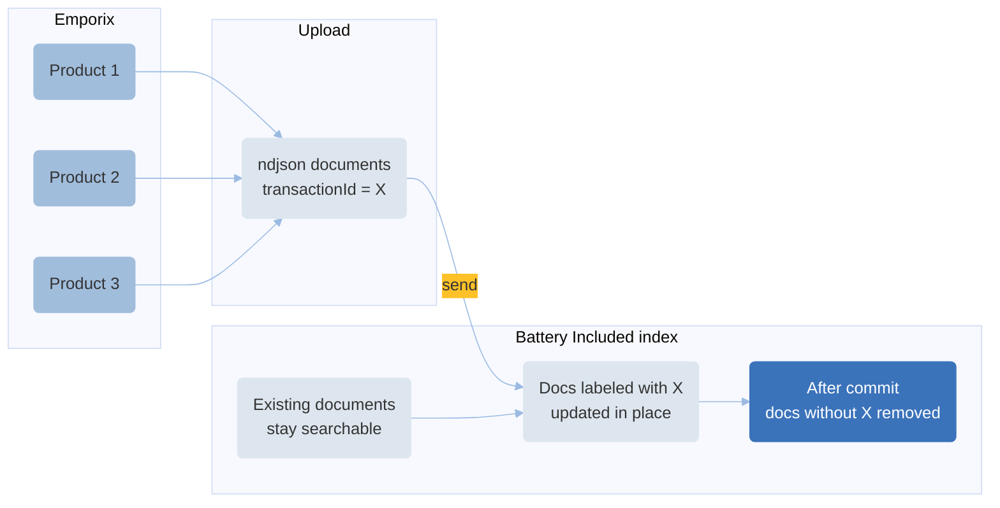

---
seo:
  title: Indexer Service Tutorials
  description: indexer, search connector
icon: graduation-cap
layout:
  width: wide
---

# Indexing Tutorial

The Indexing service is designed to manage indexing configuration. Currently supported index providers:

* [Algolia](https://www.algolia.com)
* [Battery Included](https://www.batteryincluded.io)

Proper indexing allows you to enhance your search mechanism within the Emporix system. By connecting an index provider to Commerce Engine, you get improved search functionality.


To learn more about the Indexing Service, see the [Indexing Service](./).


#### Provider mutual exclusivity

Only one provider can be active at a time per tenant. This constraint is enforced by the configuration service.

#### Battery Included limitations

Battery Included only supports the `MERGE` site-aware fields strategy. Tenants configured with the `SPLIT` strategy will have Battery Included indexing silently skipped. To set the strategy, see [How to choose indexing strategy](#how-to-choose-indexing-strategy).


For details on how Battery Included builds product documents under `MERGE`, including behavior when the default site is or is not `main`, see [How Battery Included indexes products](#how-battery-included-indexes-products).


#### Write-key validation

When you create or update a `BATTERY_INCLUDED` configuration, the indexing service validates `indexName` and `writeKey` against the host in `apiUrl`, or against the default Battery Included host when `apiUrl` is not set, before saving. Invalid credentials return `400`. If credential validation is temporarily unavailable, the request returns `502`. In both cases, the configuration is left unchanged. For details, see [How to set the Battery Included API URL](#how-to-set-the-battery-included-api-url).

Starting a product reindex while `BATTERY_INCLUDED` is active runs the same check against stored credentials before a reindex job is created.

#### Algolia limitations

By default, Algolia indexes provided by Emporix support records up to 10kB in size. In order to support larger records, you must provide your own Algolia service. For more information, please refer to documents provided by Algolia:

* [Algolia documentation](https://www.algolia.com/doc/guides/scaling/algolia-service-limits#application-record-and-index-limits)
* [Algolia FAQ](https://support.algolia.com/hc/en-us/articles/4406981897617-Is-there-a-size-limit-for-my-index-records)

For every tenant, new Algolia credentials are created and kept as `AlgoliaClient`.

The Indexing service uses separate API keys for every tenant, so that you get more flexibility in configuration.

## How to choose indexing strategy

You can choose between two indexing strategies for your search index configuration: `MERGE` and `SPLIT`. `MERGE` strategy creates a single index for all sites declared in the system, while `SPLIT` creates a separate index for each site.

Battery Included supports only `MERGE`. If the strategy is `SPLIT`, Battery Included product indexing is skipped.


For details on how Battery Included indexes products under `MERGE`, see [How Battery Included indexes products](#how-battery-included-indexes-products).


To choose the right mode for your index, send the request to the [Updating a configuration](https://developer.emporix.io/api-documentation/api-guides/configuration/configuration-service/api-reference/tenant-configurations#put-configuration-tenant-configurations-propertykey) endpoint. The request requires an OAuth2 service token with the `configuration.configuration_manage` scope.




[api-reference](../configuration-service/api-reference/)


```bash
curl -i -X PUT \
  'https://api.emporix.io/configuration/{tenant}/configurations/{propertyKey}' \
  -H 'Authorization: Bearer {{OAUTH2_ACCESS_TOKEN}}' \
  -H 'Content-Type: application/json' \
  -d '{
    "key": "indexing_siteAwareFieldsStrategy",
    "secured": false,
    "value": {
      "strategy": "SPLIT"
    },
    "version": 1
  }'
```

In the request parameters, for the `propertyKey` choose `indexing_siteAwareFieldsStrategy`. In the request body, pass the chosen strategy value. Please remain patient as propagating changes to the index strategy may take up to 1 hour, so you might not be able to see the changes instantly.

After you set the strategy, create the indexing configuration. See [How to configure search indexing](#how-to-configure-search-indexing).

## How to configure search indexing

To create indexing configuration, send a request to the [Creating new configuration](https://developer.emporix.io/api-documentation/api-guides/configuration/indexing-service/api-reference/configuration#post-indexing-tenant-configurations) endpoint.




[api-reference](../indexing-service/api-reference/)


```bash
curl -L 
  --request POST 
  --url 'https://api.emporix.io/indexing/{tenant}/configurations' 
  --header 'Content-Type: application/json' 
  --data '{
    "active": true,
    "searchKey": "84dc4886f81f805c42bdd89d64de751a",
    "applicationId": "8AP2HABA2I",
    "indexName": "exampleTenant",
    "writeKey": "51ebe89215dddcf85e5dacd5643d17e7",
    "provider": "ALGOLIA"
  }'
```

For the `BATTERY_INCLUDED` provider, the same configuration endpoints also support mixin filtering options:

- `excludedMixinKeys` - optional list of top-level mixin keys to exclude
- `includedMixinPaths` - optional list of glob patterns that allowlist mixin paths

The `BATTERY_INCLUDED` configuration also accepts `apiUrl` and `enrichments`. See [How to set the Battery Included API URL](#how-to-set-the-battery-included-api-url) and [How to choose the data that Battery Included indexing uses](#how-to-choose-the-data-that-battery-included-indexing-uses).

The `includedMixinPaths` option is matched against full dot-notation mixin paths rooted at the mixin key, for example `class_EA673_toolsClassification.sk.OnlineIsService_P`.

Supported glob syntax:

- `*` matches any characters within a single path segment
- `**` matches across one or more path segments
- `.` separates path segments

Matching is case sensitive and uses full-path matching. If a matched path points to an object, the whole subtree under that object is included.

Behavior:

- if `includedMixinPaths` is absent or an empty list (`[]`), allowlist filtering is inactive
- if `includedMixinPaths` is non-empty, only matching mixin paths are sent to Battery Included
- `includedMixinPaths` and `excludedMixinKeys` must not both be non-empty in the same request
- malformed glob patterns are rejected with a `400` validation error on configuration writes

Example of the Battery Included configuration:

```bash
curl -L \
  --request POST \
  --url 'https://api.emporix.io/indexing/{tenant}/configurations' \
  --header 'Content-Type: application/json' \
  --data '{
    "active": true,
    "indexName": "exampleTenant",
    "writeKey": "51ebe89215dddcf85e5dacd5643d17e7",
    "provider": "BATTERY_INCLUDED",
    "includedMixinPaths": [
      "*_siteAware.*.OnlineIsService_P",
      "*_siteAware.**"
    ]
  }'
```

If `writeKey` or `indexName` is wrong, the create request fails with `400` and nothing is stored. Fix the credentials in Battery Included and retry.

## How to update the index configuration

To update the index configuration you need to retrieve the `writeKey` first.
Send the request to the [Get configuration by provider name](https://developer.emporix.io/api-documentation/api-guides/configuration/indexing-service/api-reference/configuration#get-indexing-tenant-configurations-provider) endpoint.




[api-reference](../indexing-service/api-reference/)


```bash
curl -L 
  --url 'https://api.emporix.io/indexing/{tenant}/configurations' 
  --header 'Accept: */*'
```

To change configuration, make a call to the [Update configuration by provider name](https://developer.emporix.io/api-documentation/api-guides/configuration/indexing-service/api-reference/configuration#put-indexing-tenant-configurations-provider) endpoint, providing the `writeKey` from the previous step.


The update request replaces the whole configuration. For `BATTERY_INCLUDED`, a request without `apiUrl` or `enrichments` resets these fields to their defaults. Send back every field from the response of the previous step. See [How to set the Battery Included API URL](#how-to-set-the-battery-included-api-url) and [How to choose the data that Battery Included indexing uses](#how-to-choose-the-data-that-battery-included-indexing-uses).





[api-reference](../indexing-service/api-reference/)


```bash
curl -L 
  --request PUT 
  --url 'https://api.emporix.io/indexing/{tenant}/configurations/{provider}' 
  --header 'Content-Type: application/json' 
  --data '{
    "active": true,
    "searchKey": "84dc4886f81f805c42bdd89d64de751a",
    "applicationId": "8AP2HABA2I",
    "indexName": "exampleTenant",
    "writeKey": "51ebe89215dddcf85e5dacd5643d17e7",
    "provider": "ALGOLIA"
  }'
```

For `BATTERY_INCLUDED`, `includedMixinPaths` filtering is applied to the raw source mixin tree before the localized and non-localized mixin split. The retained data is then written to the existing Battery Included mixin fields, such as `_product.mixins` and `_product_i18n.<lang>.mixins`.


To apply your configuration changes to existing data, run the reindexing process. See the [How to reindex existing products](indexing.md#how_to_reindex_existing_products) section.

## How to set the Battery Included API URL

The Indexing Service sends a tenant's product data to the default Battery Included host. If Battery Included set up your index on a different host, set that host as the API URL in the `apiUrl` field of the `BATTERY_INCLUDED` configuration. The Indexing Service then sends all of the tenant's Battery Included requests to that host, including product updates, deletions, and reindex uploads. If Battery Included did not give you a host, you don't need `apiUrl`.

The `apiUrl` value must be the `https` address of a Battery Included host that Emporix accepts, for example `https://api.batteryincluded.io` or `https://api-next.batteryincluded.io`, without a path, query, fragment, user information, or port. A trailing slash is allowed. The service rejects any other value with `400` and does not store the configuration. The `apiUrl` field applies only to `BATTERY_INCLUDED`. Sending it in an `ALGOLIA` configuration also returns `400`.

The host and the write key belong together. The service validates `writeKey` against the host in `apiUrl` before saving, so use the write key that Battery Included issued for that host. A write key that is not valid on that host returns `400` with the message `Battery Included credentials are invalid. Verify the write key and index name.`, and the stored configuration stays unchanged.

To set the API URL when you create the configuration, add `apiUrl` to the request body of the [Create a new configuration](https://developer.emporix.io/api-documentation/api-guides/configuration/indexing-service/api-reference/configuration#post-indexing-tenant-configurations) endpoint.

### Prerequisites

The following items are required before you change `apiUrl`:

* The host of your index and a write key for that host, both provided by Battery Included
* An OAuth2 service token with the `indexing.search_view` and `indexing.search_manage` scopes

### Set the API URL on an existing configuration

To set the API URL on an existing `BATTERY_INCLUDED` configuration, complete the following steps:



#### Check that no product reindex is running


If you change `apiUrl` while a product reindex is running, the documents uploaded before the change stay on the old host, and the new host holds only the documents uploaded after the change.


Send a request to the [Retrieving reindex jobs](https://developer.emporix.io/api-documentation/api-guides/configuration/indexing-service/api-reference/reindex#get-indexing-tenant-reindex-jobs) endpoint.



```bash
curl -i -X GET \
  'https://api.emporix.io/indexing/{tenant}/reindex-jobs' \
  -H 'Authorization: Bearer {{OAUTH2_ACCESS_TOKEN}}'
```

Continue only when every `PRODUCT` job in the response has the `SUCCESS` or `FAILURE` status. A job with the `PENDING`, `IN_PROGRESS`, or `PUBLISHED` status has not finished yet.



#### Retrieve the current configuration

The update request replaces the whole configuration. Send a request to the [Get configuration by provider name](https://developer.emporix.io/api-documentation/api-guides/configuration/indexing-service/api-reference/configuration#get-indexing-tenant-configurations-provider) endpoint for `BATTERY_INCLUDED`.



```bash
curl -i -X GET \
  'https://api.emporix.io/indexing/{tenant}/configurations/BATTERY_INCLUDED' \
  -H 'Authorization: Bearer {{OAUTH2_ACCESS_TOKEN}}'
```

Keep every field of the response for the next step, including `includedMixinPaths`, `excludedMixinKeys`, or `enrichments` when they are set.



#### Send the configuration with the API URL

Send the whole configuration with `apiUrl` added to the [Update configuration by provider name](https://developer.emporix.io/api-documentation/api-guides/configuration/indexing-service/api-reference/configuration#put-indexing-tenant-configurations-provider) endpoint.



```bash
curl -i -X PUT \
  'https://api.emporix.io/indexing/{tenant}/configurations/BATTERY_INCLUDED' \
  -H 'Authorization: Bearer {{OAUTH2_ACCESS_TOKEN}}' \
  -H 'Content-Type: application/json' \
  -d '{
    "active": true,
    "indexName": "exampleTenant",
    "writeKey": "51ebe89215dddcf85e5dacd5643d17e7",
    "provider": "BATTERY_INCLUDED",
    "includedMixinPaths": [
      "*_siteAware.*.OnlineIsService_P",
      "*_siteAware.**"
    ],
    "apiUrl": "https://api-next.batteryincluded.io"
  }'
```

A successful request returns `204`. The [Get configuration by provider name](https://developer.emporix.io/api-documentation/api-guides/configuration/indexing-service/api-reference/configuration#get-indexing-tenant-configurations-provider) endpoint then returns the `apiUrl` value. The public configuration endpoints do not return it. See [How to retrieve public search configuration](#how-to-retrieve-public-search-configuration).

If the `apiUrl` value is not accepted, the response names the field:

```json
{
  "code": 400,
  "status": "Bad Request",
  "message": "Invalid apiUrl: must be https on one of api.batteryincluded.io, api-next.batteryincluded.io"
}
```



#### Reindex the products on the new host

A changed `apiUrl` takes effect within 10 minutes. Until then, the Indexing Service can still send requests to the previous host.

If the index on the new host does not yet hold all of the tenant's products, wait 10 minutes, and then start a full product reindex. See [How to reindex existing products](#how_to_reindex_existing_products).




If you later update the configuration without `apiUrl`, the tenant goes back to the default Battery Included host, and the write key must be valid on the default host.


## How to choose the data that Battery Included indexing uses

When the Indexing Service indexes a product for Battery Included, it always reads the product, the site settings, and the tenant configuration. It also calls other Emporix services for optional data in the search document, such as availability, prices, and customer segments. These services are the data dependencies of Battery Included indexing. If one of them is unavailable, indexing of the tenant's product updates can be delayed until it responds again. If your search does not use some of this data, you can stop calling those services. List the data dependencies to call in the `enrichments` field of the `BATTERY_INCLUDED` configuration.

The following table shows what each `enrichments` value adds to the site-specific data in `_product_siteAware`, and what changes when the value is not in the list. For the structure of the document, see [How Battery Included indexes products](#how-battery-included-indexes-products).

| Value | What it adds to the Battery Included document | When the value is not listed |
| --- | --- | --- |
| `AVAILABILITY` | Availability per site | The Availability Service is not called. Availability does not decide whether a site contributes to the merged document. `index.item-updated` webhook events have no `availability`, `available`, or `popularity` values. |
| `PRICE` | Prices per site, grouped by currency | The Price Service is not called. A site without prices still contributes to the merged document. `index.item-updated` webhook events have no `prices` values. |
| `CUSTOMER_SEGMENT` | Segment IDs per site | The Customer Segment Service is not called. `index.item-updated` webhook events have no `segmentIds` values. |
| `FEE` | No data, because fee data is not part of the Battery Included document | The Fee Service is not called. Battery Included search does not need `FEE`. |

The following rules apply to the `enrichments` list:

* When `enrichments` is not set, the Indexing Service uses `AVAILABILITY`, `PRICE`, and `CUSTOMER_SEGMENT`, and does not call the Fee Service. The configuration endpoints then do not return the field.
* An empty list means that no data dependency is called.
* Values are case sensitive. A list with an unknown or `null` value returns `400`, and the configuration is not stored.
* The field applies only to `BATTERY_INCLUDED`. Sending it in an `ALGOLIA` configuration, even as an empty list, also returns `400`.
* Algolia indexing and product reindex jobs with `rag` set to `true` ignore `enrichments` and always call every data dependency.

For how a value that is not listed changes which sites contribute to the merged document, see [When a data dependency is not listed](#when-a-data-dependency-is-not-listed).


When you remove a value from the list, its data is removed from each product's Battery Included document the next time the product is updated or reindexed. A full product reindex removes it from all products at once. Search features that filter or sort by that data, for example by price, stop working for the affected products.

Removing `PRICE` or `AVAILABILITY` can also add products to the index. Products that were left out because their default site had no prices or was unavailable are added after their next update or a reindex. Adding the value back removes those products again.


To choose the data when you create the configuration, add `enrichments` to the request body of the [Create a new configuration](https://developer.emporix.io/api-documentation/api-guides/configuration/indexing-service/api-reference/configuration#post-indexing-tenant-configurations) endpoint.

### Prerequisites

The following items are required before you change `enrichments`:

* A `BATTERY_INCLUDED` configuration on a tenant that uses the `MERGE` strategy
* The write key and index name of that configuration. The update request validates them again against the configured Battery Included host.
* An OAuth2 service token with the `indexing.search_view` and `indexing.search_manage` scopes

### Change the data on an existing configuration

To change the data that Battery Included indexing uses, complete the following steps:



#### Retrieve the current configuration

The update request replaces the whole configuration. Send a request to the [Get configuration by provider name](https://developer.emporix.io/api-documentation/api-guides/configuration/indexing-service/api-reference/configuration#get-indexing-tenant-configurations-provider) endpoint for `BATTERY_INCLUDED`.



```bash
curl -i -X GET \
  'https://api.emporix.io/indexing/{tenant}/configurations/BATTERY_INCLUDED' \
  -H 'Authorization: Bearer {{OAUTH2_ACCESS_TOKEN}}'
```

Keep every field of the response for the next step, including `apiUrl`, `includedMixinPaths`, or `excludedMixinKeys` when they are set.



#### Send the configuration with the `enrichments` list

Send the whole configuration with `enrichments` added to the [Update configuration by provider name](https://developer.emporix.io/api-documentation/api-guides/configuration/indexing-service/api-reference/configuration#put-indexing-tenant-configurations-provider) endpoint. The following example keeps availability and prices, and stops calling the Customer Segment Service.



```bash
curl -i -X PUT \
  'https://api.emporix.io/indexing/{tenant}/configurations/BATTERY_INCLUDED' \
  -H 'Authorization: Bearer {{OAUTH2_ACCESS_TOKEN}}' \
  -H 'Content-Type: application/json' \
  -d '{
    "active": true,
    "indexName": "exampleTenant",
    "writeKey": "51ebe89215dddcf85e5dacd5643d17e7",
    "provider": "BATTERY_INCLUDED",
    "includedMixinPaths": [
      "*_siteAware.*.OnlineIsService_P",
      "*_siteAware.**"
    ],
    "enrichments": [
      "AVAILABILITY",
      "PRICE"
    ]
  }'
```

A successful request returns `204`. The [Get configuration by provider name](https://developer.emporix.io/api-documentation/api-guides/configuration/indexing-service/api-reference/configuration#get-indexing-tenant-configurations-provider) endpoint then returns the `enrichments` list as you sent it. The public configuration endpoints do not return it. See [How to retrieve public search configuration](#how-to-retrieve-public-search-configuration).

If a value is not accepted, the response names the field:

```json
{
  "code": 400,
  "status": "Bad Request",
  "message": "Invalid 'enrichments': unknown value(s) [STOCK]; allowed: [AVAILABILITY, PRICE, CUSTOMER_SEGMENT, FEE]"
}
```



#### Apply the change to existing products

A changed `enrichments` list takes effect within 10 minutes. After that, each product uses the new list the next time it is updated or reindexed.

To apply the new list to all products at once, wait 10 minutes, and then start a full product reindex. See [How to reindex existing products](#how_to_reindex_existing_products).




If you later update the configuration without `enrichments`, the tenant goes back to the default list: `AVAILABILITY`, `PRICE`, and `CUSTOMER_SEGMENT`.


## How Battery Included indexes products

When the tenant uses `MERGE`, the Indexing Service builds one Battery Included search document per product. Core product fields come from a single base site.

The Battery Included document stores site-specific data in `_product_siteAware`. This field is a map whose keys are site codes.
Each value can contain prices grouped by currency, availability, and segment IDs for that site. Availability can appear for a site
even when that site has no prices.

If your tenant uses `SPLIT`, Battery Included product indexing is skipped.


To set the strategy, see [How to choose indexing strategy](#how-to-choose-indexing-strategy).


### How the base site is chosen

When the Indexing Service merges per-site product data into one document, it picks the base site in this order:

1. A site that matches one of the tenant default sites
2. The `main` site, if no matching default-site data is available
3. The first available site, if neither of the above matches

The merged document is stored under site code `main`, which is how `MERGE` keeps a single per-product document.

### Special rules for the `main` site

For the `main` site, a product can still be indexed when it is unpublished, has no prices, or is unavailable.

For any other site, those conditions mean that site does not contribute prices, availability, or segment IDs to the merged document. If the chosen base site is such a site, the product is removed from Battery Included.

Missing prices affect these rules only while `PRICE` is in the tenant's `enrichments` list, and missing availability only while `AVAILABILITY` is in it. Both are in the default list. See [When a data dependency is not listed](#when-a-data-dependency-is-not-listed).

### When the default site is `main`

When a tenant default site is `main`, the following applies:

- Base product fields come from `main`.
- The `main` site rules above apply to the base site, so unpublished, no-price, or unavailable status on that default site does not by itself remove the product from Battery Included.
- Sites that still contribute data write their prices, availability, and segment IDs to `_product_siteAware`.

### When the default site is not `main`

When the matching tenant default site is not `main`, the following applies:

- Base product fields come from that default site when it still contributes data.
- If that default site would not index the product (for example because it is unpublished, has no price, or is unavailable), the product is removed from Battery Included.
- Otherwise, `_product_siteAware` still includes every site that contributed prices, availability, or segment IDs.

### When a data dependency is not listed

When a value is not in the tenant's `enrichments` list, the Indexing Service does not call that data dependency for any site, including `main`. A missing price or missing availability then no longer stops a site from contributing to the merged document.

The following applies when `PRICE` or `AVAILABILITY` is not listed:

- Without `PRICE`, a site without prices still contributes to the merged document. A default site that is not `main` and has no prices does not remove the product from Battery Included.
- Without `AVAILABILITY`, availability does not decide whether a site contributes to the merged document. A default site that is not `main` and is unavailable does not remove the product from Battery Included.

These rules apply to product updates and to product reindexes. Other conditions still apply. For example, a site where the product is unpublished does not contribute to the merged document.

The data of a value that is not listed is missing from `_product_siteAware` and from [`index.item-updated`](../../webhooks/events-index.md) webhook events. For the values and how to set them, see [How to choose the data that Battery Included indexing uses](#how-to-choose-the-data-that-battery-included-indexing-uses).

### How site-aware mixins are indexed

The Indexing Service recognizes a mixin as site-aware when the source product contains an overlay key in the form
`{mixin}__{site}`. This key convention controls Battery Included indexing even if the mixin schema is not marked as site-aware.
However, mark the schema with `siteAware: true` so that the product follows the standard
[site-aware mixin](../../standard-practices/mixins.md#site-aware-mixins) model. Declare only the base mixin under `metadata.mixins`.
If no schema URL is declared or the schema lookup fails, the merged mixin stays under
`_product_siteAware.<site>.mixins.<mixin>`.

For each site in `_product_siteAware`, the Indexing Service deep-merges the matching overlay into the base mixin. Nested overlay
fields replace matching base fields, while the other base fields remain. A `null` overlay value does not clear the base value. The
existing site eligibility rules determine which prices, availability, and segment IDs contribute to the document. A site with
contributing commercial data receives an `_product_siteAware` entry and gets the base mixin when it has no matching overlay. An
overlay key also creates the site entry when no commercial data exists for that site.

After the merge, schema-identified localized fields and non-localized fields use separate paths:

* `_product_siteAware.<site>.mixins.<mixin>` contains the non-localized part of the merged mixin.
* `_product_siteAware.<site>.localeAware.<language>.mixins.<mixin>` contains its localized part.

The site-aware base and overlay roots do not remain in `_product.mixins` or `_product_i18n.<language>.mixins`. Mixins without an
overlay key remain non-site-aware. Their non-localized fields use `_product.mixins`, and schema-identified localized fields use
`_product_i18n.<language>.mixins`.

The following source product fragment contains a `productInfo` base, a `main` overlay, and a non-site-aware `internalFlags` mixin.
The mixin schemas identify `title` and `note` as localized fields:

```json
{
  "mixins": {
    "productInfo": {
      "skuHint": "BASE",
      "details": {
        "material": "cotton",
        "care": {
          "temperature": 30
        }
      },
      "title": {
        "en": "Shirt",
        "de": "Hemd"
      }
    },
    "productInfo__main": {
      "skuHint": "MAIN",
      "details": {
        "care": {
          "temperature": 40
        }
      },
      "title": {
        "de": "Premiumhemd"
      }
    },
    "internalFlags": {
      "hidden": false,
      "note": {
        "en": "Operations",
        "de": "Betrieb"
      }
    }
  },
  "metadata": {
    "mixins": {
      "productInfo": "https://example.com/schemas/productInfo-v1.json",
      "internalFlags": "https://example.com/schemas/internalFlags-v1.json"
    }
  }
}
```

Assume both `main` and `germany` contribute commercial data to the document. The relevant output has the following shape:

```json
{
  "_product": {
    "mixins": {
      "internalFlags": {
        "hidden": false
      }
    }
  },
  "_product_i18n": {
    "en": {
      "mixins": {
        "internalFlags": {
          "note": "Operations"
        }
      }
    },
    "de": {
      "mixins": {
        "internalFlags": {
          "note": "Betrieb"
        }
      }
    }
  },
  "_product_siteAware": {
    "main": {
      "segmentIds": [
        "seg-main"
      ],
      "mixins": {
        "productInfo": {
          "skuHint": "MAIN",
          "details": {
            "material": "cotton",
            "care": {
              "temperature": 40
            }
          }
        }
      },
      "localeAware": {
        "en": {
          "mixins": {
            "productInfo": {
              "title": "Shirt"
            }
          }
        },
        "de": {
          "mixins": {
            "productInfo": {
              "title": "Premiumhemd"
            }
          }
        }
      }
    },
    "germany": {
      "segmentIds": [
        "seg-germany"
      ],
      "mixins": {
        "productInfo": {
          "skuHint": "BASE",
          "details": {
            "material": "cotton",
            "care": {
              "temperature": 30
            }
          }
        }
      },
      "localeAware": {
        "en": {
          "mixins": {
            "productInfo": {
              "title": "Shirt"
            }
          }
        },
        "de": {
          "mixins": {
            "productInfo": {
              "title": "Hemd"
            }
          }
        }
      }
    }
  }
}
```

Commercial fields keep their existing paths and behavior. For example, `segmentIds`, `availability`, and `currencyAware` remain
siblings of `mixins` and `localeAware` under each `_product_siteAware.<site>` entry.

Mixin filters also keep their existing behavior. The Indexing Service applies `includedMixinPaths` and `excludedMixinKeys` to the
raw source mixin tree before it detects site-aware roots, merges overlays, or separates localized values. Filter patterns therefore
match source paths such as `productInfo` and `productInfo__main`, not the generated `_product_siteAware` paths.

### Migrating from legacy mixin paths


To keep existing integrations working after a rollout, incremental update, or reindex, add support for the new paths before the new
document shape reaches the index. Retain fallback reads from the old paths during the transition.




#### Add dual-read support

Update consumers to read non-localized values from `_product_siteAware.<site>.mixins.<mixin>` and localized values from
`_product_siteAware.<site>.localeAware.<language>.mixins.<mixin>`. Here, `<mixin>` is the base mixin key, `<site>` is the tenant
site code used as the overlay suffix, and `<language>` is a language key found in the localized mixin data.

Use the following legacy paths when the corresponding new path is absent:

* For non-localized values, use the base `_product.mixins.<mixin>` and overlay `_product.mixins.<mixin>__<site>` paths.
* For localized values, use the base `_product_i18n.<language>.mixins.<mixin>` and overlay
  `_product_i18n.<language>.mixins.<mixin>__<site>` paths.

The consumer deep-merges the legacy overlay value into the legacy base value during fallback. A `null` overlay value preserves the
base value.



#### Roll out the change

Roll out the change and keep both reads while old and new document shapes coexist. Run a
[full reindex](#how_to_reindex_existing_products) to migrate all products in a bounded operation. If you rely on incremental updates
without a full reindex, both shapes can coexist indefinitely. Keep the fallback reads in that case.



#### Remove fallbacks after a full reindex

If you run a full reindex, wait until it reports `SUCCESS`, then allow Battery Included time to apply the transaction cleanup.
Verify through your search integration that reindexed documents contain the `_product_siteAware` paths. Remove the old-path
fallbacks after this verification. If you use only incremental updates, skip this step and keep the fallbacks.



To rebuild the Battery Included index after configuration changes, see [How to reindex existing products](#how_to_reindex_existing_products).

## How to reindex existing products <a href="#how_to_reindex_existing_products" id="how_to_reindex_existing_products"></a>

Usually, reindexing runs upon the update of a product or its dependant entity, such as category, price, or media. The scheduler job discovers what has been changed and pushes the changes to index frequently.
But, if you change your index configuration, you need to trigger the reindexing process to apply your configuration changes.
You can run the reindex without the need to update all your resource data by sending the request to the [Creating a reindex job](https://developer.emporix.io/api-documentation/api-guides/configuration/indexing-service/api-reference/reindex#post-indexing-tenant-reindex-jobs) endpoint. Creating a job requires an OAuth2 service token with the `indexing.search_manage` scope. Tracking the job with [Retrieving a reindex job](https://developer.emporix.io/api-documentation/api-guides/configuration/indexing-service/api-reference/reindex#get-indexing-tenant-reindex-jobs-reindexjobid) requires `indexing.search_view`.




[api-reference](../indexing-service/api-reference/)


```bash
curl -i -X POST \
  'https://api.emporix.io/indexing/{tenant}/reindex-jobs' \
  -H 'Authorization: Bearer {{OAUTH2_ACCESS_TOKEN}}' \
  -H 'Content-Type: application/json' \
  -d '{
    "entityType": "PRODUCT"
  }'
```

A successful response returns a reindex job, including its `id`. You can track progress with the [Retrieving a reindex job](https://developer.emporix.io/api-documentation/api-guides/configuration/indexing-service/api-reference/reindex#get-indexing-tenant-reindex-jobs-reindexjobid) endpoint. The job runs in full mode for the selected `entityType`. For Battery Included product reindexes, see [How Battery Included reindexing works](#how-battery-included-reindexing-works).

### How Battery Included reindexing works

When a product reindex job is created for `BATTERY_INCLUDED`, the Indexing Service uploads documents to Battery Included and cleans up the index after commit.

Each upload and the final commit go to the Battery Included host that is configured for the tenant when that upload or commit is sent, with the write key from the same configuration. To avoid splitting a reindex across two hosts, don't change `apiUrl` while a reindex is running. See [How to set the Battery Included API URL](#how-to-set-the-battery-included-api-url).

When the active provider is `BATTERY_INCLUDED`, a full product reindex does not empty the index at the start. Existing documents stay searchable while the Indexing Service uploads the new set. Emporix completes the upload and runs cleanup for you. You can track progress with the [Retrieving a reindex job](https://developer.emporix.io/api-documentation/api-guides/configuration/indexing-service/api-reference/reindex#get-indexing-tenant-reindex-jobs-reindexjobid) endpoint.

Use `processedCount` to see how many entities Emporix has already processed. When the count is close to `expectedCount`, Emporix has sent the remaining documents to Battery Included; allow a short time for Battery Included to finish applying them.

While a reindex job is `IN_PROGRESS`, live product updates are not written to the index immediately. They are queued and applied after the reindex completes.

Each reindex job has an `id`, and that value is sent to Battery Included as `transactionId` on every document that belongs to the job. Eligible products are uploaded with this label. If a matching document is already in the index, it is updated in place in the same way as during normal incremental indexing, and labeled with the current `transactionId`. Products that are not eligible for reindexing are not sent. Eligibility follows the same Battery Included indexing rules as day-to-day updates; see [How Battery Included indexes products](#how-battery-included-indexes-products).

When every document intended for the job has been sent, the upload is committed. A job status of `SUCCESS` means the reindex transaction was committed. After commit, Battery Included removes documents that were not sent with this `transactionId`, so the index should not retain documents that were not part of the job. The cleanup applies only to the Battery Included search index for the tenant and this reindex transaction; it does not delete products in Emporix. Until commit and cleanup are finished, search can still return documents that the current job has not replaced. After cleanup, the index matches the documents labeled with that `transactionId`.




For `BATTERY_INCLUDED` product reindexes, invalid stored credentials return `Battery Included credentials are invalid. Verify the write key and index name.` No reindex job is created. Update the configuration first, then retry. If Battery Included is temporarily unreachable, the request returns `502` with `Battery Included credential validation is temporarily unavailable. Try again later.`


## How to retrieve public search configuration

How to retrieve public search configuration

If you want to get your storefront index configuration without the need to update, you can call the public endpoint to get the `searchKey`. Send the request to the [Get all public configurations](https://developer.emporix.io/api-documentation/api-guides/configuration/indexing-service/api-reference/public-configuration#get-indexing-tenant-public-configurations) endpoint.




[api-reference](../indexing-service/api-reference/)


```bash
curl -i -X GET \
  'https://api.emporix.io/indexing/{tenant}/public/configurations' \
  -H 'Accept: */*'
```
