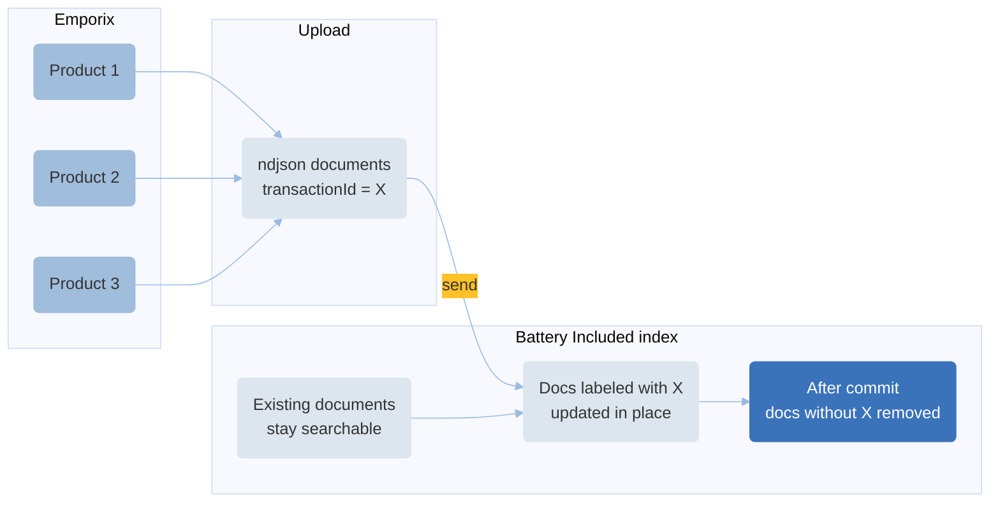

---
seo:
  title: Indexer Service Tutorials
  description: indexer, search connector
icon: graduation-cap
layout:
  width: wide
---

# Indexing Tutorial

The Indexing service is designed to manage indexing configuration. Currently supported index providers:

* [Algolia](https://www.algolia.com)
* [Battery Included](https://www.batteryincluded.io)

Proper indexing allows you to enhance your search mechanism within the Emporix system. By connecting an index provider to Commerce Engine, you get improved search functionality.


To learn more about the Indexing Service, see the [Indexing Service](./).


#### Provider mutual exclusivity

Only one provider can be active at a time per tenant. This constraint is enforced by the configuration service.

#### Battery Included limitations


This functionality is in preview mode - some of the features may not be fully operational yet. The payload sent to Battery Included is subject to change.


Battery Included only supports the `MERGE` site-aware fields strategy. Tenants configured with the `SPLIT` strategy will have Battery Included indexing silently skipped. To set the strategy, see [How to choose indexing strategy](#how-to-choose-indexing-strategy).


For details on how Battery Included builds product documents under `MERGE`, including behavior when the default site is or is not `main`, see [How Battery Included indexes products](#how-battery-included-indexes-products).


#### Write-key validation

When you create or update a `BATTERY_INCLUDED` configuration, the indexing service validates `indexName` and `writeKey` before saving. Invalid credentials return `400`. If credential validation is temporarily unavailable, the request returns `502`. In both cases, the configuration is left unchanged.

Starting a product reindex while `BATTERY_INCLUDED` is active runs the same check against stored credentials before a reindex job is created.

#### Algolia limitations

By default, Algolia indexes provided by Emporix support records up to 10kB in size. In order to support larger records, you must provide your own Algolia service. For more information, please refer to documents provided by Algolia:

* [Algolia documentation](https://www.algolia.com/doc/guides/scaling/algolia-service-limits#application-record-and-index-limits)
* [Algolia FAQ](https://support.algolia.com/hc/en-us/articles/4406981897617-Is-there-a-size-limit-for-an-index-records)

For every tenant, new Algolia credentials are created and kept as `AlgoliaClient`.

The Indexing service uses separate API keys for every tenant, so that you get more flexibility in configuration.

## How to choose indexing strategy

You can choose between two indexing strategies for your search index configuration: `MERGE` and `SPLIT`. `MERGE` strategy creates a single index for all sites declared in the system, while `SPLIT` creates a separate index for each site.

Battery Included supports only `MERGE`. If the strategy is `SPLIT`, Battery Included product indexing is skipped.


For details on how Battery Included indexes products under `MERGE`, see [How Battery Included indexes products](#how-battery-included-indexes-products).


To choose the right mode for your index, send the request to the [Updating a configuration](https://developer.emporix.io/api-documentation/api-guides/configuration/configuration-service/api-reference/tenant-configurations#put-configuration-tenant-configurations-propertykey) endpoint.




[api-reference](../configuration-service/api-reference/)


```bash
curl -L 
  --request PUT 
  --url 'https://api.emporix.io/configuration/{tenant}/configurations/{propertyKey}' 
  --header 'Content-Type: application/json' 
  --data '{
    "key": "indexing_siteAwareFieldsStrategy",
    "secured": false,
    "value": {
    "strategy": "SPLIT"
  },
    "version": 1
}
```

In the request parameters, for the `propertyKey` choose `indexing_siteAwareFieldsStrategy`. In the request body, pass the chosen strategy value. Please remain patient as propagating changes to the index strategy may take up to 1 hour, so you might not be able to see the changes instantly.

After you set the strategy, create the indexing configuration. See [How to configure search indexing](#how-to-configure-search-indexing).

## How to configure search indexing

To create indexing configuration, send a request to the [Creating new configuration](https://developer.emporix.io/api-documentation/api-guides/configuration/indexing-service/api-reference/configuration#post-indexing-tenant-configurations) endpoint.




[api-reference](../indexing-service/api-reference/)


```bash
curl -L 
  --request POST 
  --url 'https://api.emporix.io/indexing/{tenant}/configurations' 
  --header 'Content-Type: application/json' 
  --data '{
    "active": true,
    "searchKey": "84dc4886f81f805c42bdd89d64de751a",
    "applicationId": "8AP2HABA2I",
    "indexName": "exampleTenant",
    "writeKey": "51ebe89215dddcf85e5dacd5643d17e7",
    "provider": "ALGOLIA"
  }'
```

For the `BATTERY_INCLUDED` provider, the same configuration endpoints also support mixin filtering options:

- `excludedMixinKeys` - optional list of top-level mixin keys to exclude
- `includedMixinPaths` - optional list of glob patterns that allowlist mixin paths

The `includedMixinPaths` option is matched against full dot-notation mixin paths rooted at the mixin key, for example `class_EA673_toolsClassification.sk.OnlineIsService_P`.

Supported glob syntax:

- `*` matches any characters within a single path segment
- `**` matches across one or more path segments
- `.` separates path segments

Matching is case sensitive and uses full-path matching. If a matched path points to an object, the whole subtree under that object is included.

Behavior:

- if `includedMixinPaths` is absent or an empty list (`[]`), allowlist filtering is inactive
- if `includedMixinPaths` is non-empty, only matching mixin paths are sent to Battery Included
- `includedMixinPaths` and `excludedMixinKeys` must not both be non-empty in the same request
- malformed glob patterns are rejected with a `400` validation error on configuration writes

Example of the Battery Included configuration:

```bash
curl -L \
  --request POST \
  --url 'https://api.emporix.io/indexing/{tenant}/configurations' \
  --header 'Content-Type: application/json' \
  --data '{
    "active": true,
    "indexName": "exampleTenant",
    "writeKey": "51ebe89215dddcf85e5dacd5643d17e7",
    "provider": "BATTERY_INCLUDED",
    "includedMixinPaths": [
      "*_siteAware.*.OnlineIsService_P",
      "*_siteAware.**"
    ]
  }'
```

If `writeKey` or `indexName` is wrong, the create request fails with `400` and nothing is stored. Fix the credentials in Battery Included and retry.


## How to update the index configuration

To update the index configuration you need to retrieve the `writeKey` first.
Send the request to the [Get configuration by provider name](https://developer.emporix.io/api-documentation/api-guides/configuration/indexing-service/api-reference/configuration#get-indexing-tenant-configurations-provider) endpoint.




[api-reference](../indexing-service/api-reference/)


```bash
curl -L 
  --url 'https://api.emporix.io/indexing/{tenant}/configurations' 
  --header 'Accept: */*'
```

To change configuration, make a call to the [Update configuration by provider name](https://developer.emporix.io/api-documentation/api-guides/configuration/indexing-service/api-reference/configuration#put-indexing-tenant-configurations-provider) endpoint, providing the `writeKey` from the previous step.




[api-reference](../indexing-service/api-reference/)


```bash
curl -L 
  --request PUT 
  --url 'https://api.emporix.io/indexing/{tenant}/configurations/{provider}' 
  --header 'Content-Type: application/json' 
  --data '{
    "active": true,
    "searchKey": "84dc4886f81f805c42bdd89d64de751a",
    "applicationId": "8AP2HABA2I",
    "indexName": "exampleTenant",
    "writeKey": "51ebe89215dddcf85e5dacd5643d17e7",
    "provider": "ALGOLIA"
  }'
```

For `BATTERY_INCLUDED`, `includedMixinPaths` filtering is applied to the raw source mixin tree before the localized and non-localized mixin split. The retained data is then written to the existing Battery Included mixin fields, such as `_product.mixins` and `_product_i18n.<lang>.mixins`.


To apply your configuration changes to existing data, run the reindexing process. See the [How to reindex existing products](indexing.md#how_to_reindex_existing_products) section.

## How Battery Included indexes products

When the tenant uses `MERGE`, the Indexing Service builds one Battery Included search document per product. Core product fields come from a single base site.

The Battery Included document stores site-specific data in `_product_siteAware`. This field is a map whose keys are site codes.
Each value can contain prices grouped by currency, availability, and segment IDs for that site. Availability can appear for a site
even when that site has no prices.

If your tenant uses `SPLIT`, Battery Included product indexing is skipped.


To set the strategy, see [How to choose indexing strategy](#how-to-choose-indexing-strategy).


### How the base site is chosen

When the Indexing Service merges per-site product data into one document, it picks the base site in this order:

1. A site that matches one of the tenant default sites
2. The `main` site, if no matching default-site data is available
3. The first available site, if neither of the above matches

The merged document is stored under site code `main`, which is how `MERGE` keeps a single per-product document.

### Special rules for the `main` site

For the `main` site, a product can still be indexed when it is unpublished, has no prices, or is unavailable.

For any other site, those conditions mean that site does not contribute prices, availability, or segment IDs to the merged document. If the chosen base site is such a site, the product is removed from Battery Included.

### When the default site is `main`

When a tenant default site is `main`, the following applies:

- Base product fields come from `main`.
- The `main` site rules above apply to the base site, so unpublished, no-price, or unavailable status on that default site does not by itself remove the product from Battery Included.
- Sites that still contribute data write their prices, availability, and segment IDs to `_product_siteAware`.

### When the default site is not `main`

When the matching tenant default site is not `main`, the following applies:

- Base product fields come from that default site when it still contributes data.
- If that default site would not index the product (for example because it is unpublished, has no price, or is unavailable), the product is removed from Battery Included.
- Otherwise, `_product_siteAware` still includes every site that contributed prices, availability, or segment IDs.

To rebuild the Battery Included index after configuration changes, see [How to reindex existing products](#how_to_reindex_existing_products).

## How to reindex existing products <a href="#how_to_reindex_existing_products" id="how_to_reindex_existing_products"></a>

Usually, reindexing runs upon the update of a product or its dependant entity, such as category, price, or media. The scheduler job discovers what has been changed and pushes the changes to index frequently.
But, if you change your index configuration, you need to trigger the reindexing process to apply your configuration changes.
You can run the reindex without the need to update all your resource data by sending the request to the [Creating a reindex job](https://developer.emporix.io/api-documentation/api-guides/configuration/indexing-service/api-reference/reindex#post-indexing-tenant-reindex-jobs) endpoint.




[api-reference](../indexing-service/api-reference/)


```bash
curl -i -X POST \
  'https://api.emporix.io/indexing/{tenant}/reindex-jobs' \
  -H 'Authorization: Bearer {{OAUTH2_ACCESS_TOKEN}}' \
  -H 'Content-Type: application/json' \
  -d '{
    "entityType": "PRODUCT"
  }'
```

A successful response returns a reindex job, including its `id`. You can track progress with the [Retrieving a reindex job](https://developer.emporix.io/api-documentation/api-guides/configuration/indexing-service/api-reference/reindex#get-indexing-tenant-reindex-jobs-reindexjobid) endpoint. The job runs in full mode for the selected `entityType`.

For `BATTERY_INCLUDED` product reindexes, invalid stored credentials return:

`Battery Included credentials are invalid. Verify the write key and index name.`

No reindex job is created. Update the configuration first, then retry. If Battery Included is temporarily unreachable, the request returns `502` with:

`Battery Included credential validation is temporarily unavailable. Try again later.`

When a product reindex job is created for `BATTERY_INCLUDED`, the Indexing Service uploads documents to Battery Included and cleans up the index after commit. The following section describes that lifecycle.

### How Battery Included reindexing works

When the active provider is `BATTERY_INCLUDED`, a full product reindex does not empty the index at the start. Existing documents stay searchable while the Indexing Service uploads the new set. Emporix completes the upload and runs cleanup for you. You can track progress with the [Retrieving a reindex job](https://developer.emporix.io/api-documentation/api-guides/configuration/indexing-service/api-reference/reindex#get-indexing-tenant-reindex-jobs-reindexjobid) endpoint.

Each reindex job has an `id`, and that value is sent to Battery Included as `transactionId` on every document that belongs to the job. Eligible products are uploaded with this label. If a matching document is already in the index, it is updated in place in the same way as during normal incremental indexing, and labeled with the current `transactionId`. Products that are not eligible for reindexing are not sent. Eligibility follows the same Battery Included indexing rules as day-to-day updates; see [How Battery Included indexes products](#how-battery-included-indexes-products).

When every document intended for the job has been sent, the upload is committed. After commit, Battery Included removes documents that were not sent with this `transactionId`. The cleanup applies only to the Battery Included search index for the tenant and this reindex transaction; it does not delete products in Emporix. Until commit and cleanup are finished, search can still return documents that the current job has not replaced. After cleanup, the index matches the set of documents labeled with the committed `transactionId`.



## How to retrieve public search configuration

How to retrieve public search configuration

If you want to get your storefront index configuration without the need to update, you can call the public endpoint to get the `searchKey`. Send the request to the [Get all public configurations](https://developer.emporix.io/api-documentation/api-guides/configuration/indexing-service/api-reference/public-configuration#get-indexing-tenant-public-configurations) endpoint.




[api-reference](../indexing-service/api-reference/)


```bash
curl -L 
  --url 'https://api.emporix.io/indexing/{tenant}/public/configurations' 
  --header 'Accept: */*'
```
