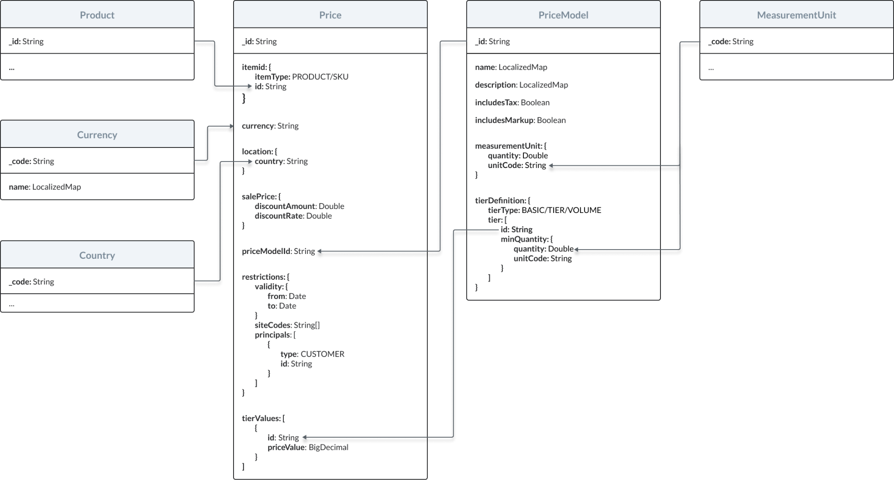
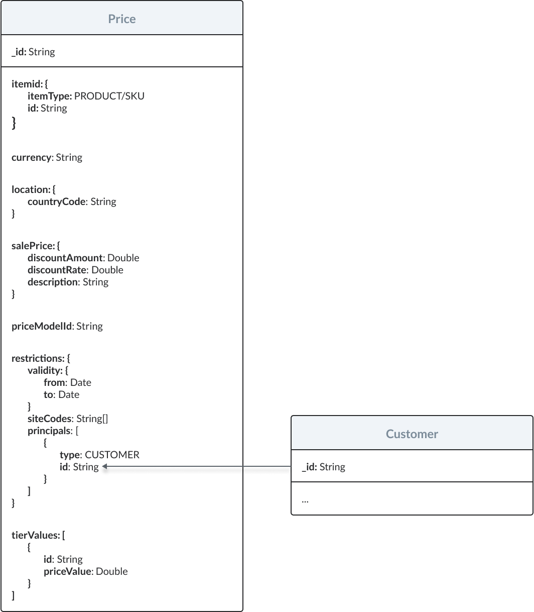
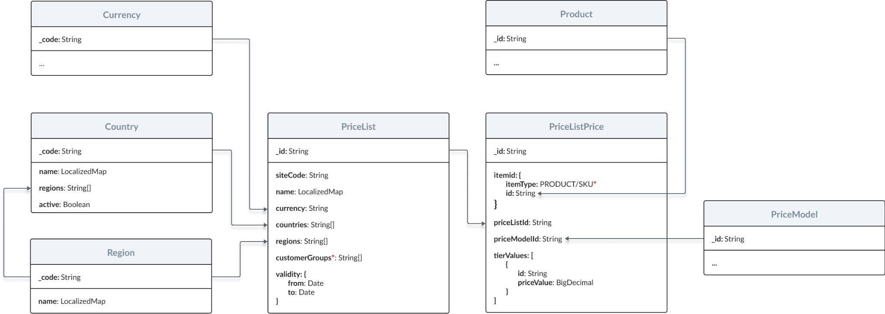
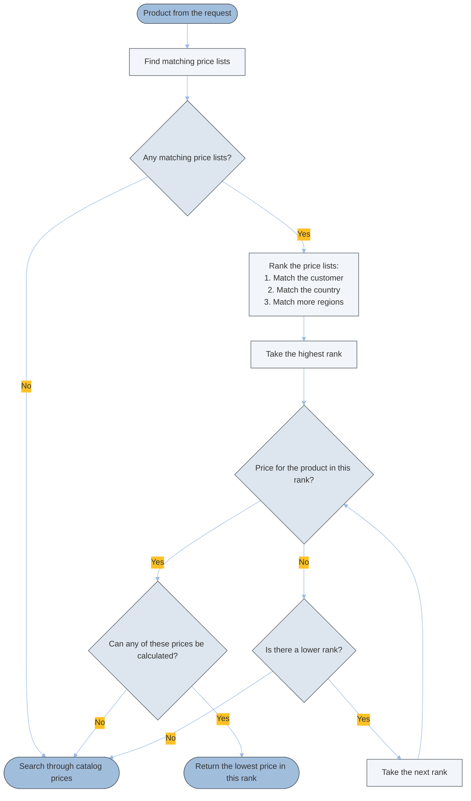

---
seo:
  title: Price Service Tutorials
  description: price, prices, price list, price lists, price personalization,
icon: graduation-cap
layout:
  width: wide
  title:
    visible: true
  description:
    visible: true
  tableOfContents:
    visible: true
  outline:
    visible: true
  pagination:
    visible: true
  metadata:
    visible: true
---

# Price Tutorials

## How to set up your first price

Take a look at the relationships between prices and other resources in the Emporix Commerce Engine.

<figure><figcaption></figcaption></figure>

This tutorial will walk you through the following steps:

1. [Specifying accepted currencies](price.md#specify-accepted-currencies).
2. [Creating a price model](price.md#create-a-price-model).
3. [Retrieving a tier ID](price.md#retrieve-a-tier-id).
4. [Defining a price](price.md#define-the-price).


The tutorial skips the step of creating a new measurement unit as your Emporix tenant is configured with the most commonly used measurement units out-of-the-box.

To learn more about measurement units in the Emporix Commerce Engine, check out the [Measurement units guide](https://app.gitbook.com/s/bTY7EwZtYYQYC6GOcdTj/core-commerce/unit-handling).


### Specify accepted currencies

Each currency accepted by your business is stored as a separate object that can be managed through the Emporix API [Currency Service](../../configuration/currency-service/).

To add a new entry to your configuration of currencies, you need to send a request to the [Creating a new currency](https://developer.emporix.io/api-documentation/api-guides/configuration/currency-service/api-reference/currencies#post-currency-tenant-currencies) endpoint.




[api-reference](../../configuration/currency-service/api-reference/)


```bash
curl -i -X POST 
  'https://api.emporix.io/currency/{tenant}/currencies' 
  -H 'Authorization: Bearer {{OAUTH2_ACCESS_TOKEN}}' 
  -H 'Content-Language: de' 
  -H 'Content-Type: application/json' 
  -d '{
  "code": "EUR",
  "name": {
    "en": "Euro",
    "pl": "Euro"
  }
}'
```

### Create a price model

A price model defines a repeatable way to sell products. You can create separate price models depending on measurement units for which prices are expressed or depending on products' pricing strategies.


To learn more about price models in the Emporix Commerce Engine, check out the [Pricing guide](https://app.gitbook.com/o/z8MNPigQv25NZe33g3AV/s/bTY7EwZtYYQYC6GOcdTj/core-commerce/pricing/pricing-v2#price-models).


To create a new price model, you need to send a request to the [Creating a new price model](https://developer.emporix.io/api-documentation/api-guides/prices-and-taxes/price-service/api-reference/price-models#post-price-tenant-pricemodels) endpoint.




[api-reference](api-reference/)


```bash
curl -i -X POST 
  'https://api.emporix.io/price/{tenant}/priceModels' 
  -H 'Authorization: Bearer {{OAUTH2_ACCESS_TOKEN}}' 
  -H 'Content-Language: string' 
  -H 'Content-Type: application/json' 
  -d '{
      "includesTax": true,
      "includesMarkup": false,
      "name": {
        "en": "Price model - per piece",
        "de": "Preismodell - pro Stück"
      },
      "description": {
        "en": "Price model for goods sold by the piece.",
        "de": "Preismodell für stückweise verkaufte Ware."
      },
      "tierDefinition": {
        "tierType": "BASIC",
        "tiers": [
          {
            "minQuantity": {
              "quantity": 0,
              "unitCode": "pc"
            }
          }
        ]
      },
      "measurementUnit": {
        "quantity": 1,
        "unitCode": "pc"
      }
    }'
```

### Retrieve a tier ID

When specifying a price for a product, you need to reference two values from a corresponding price model:

* ID of the price model
* ID of the model's relevant pricing tier

Price models that use the basic pricing strategy have one tier. To retrieve its ID, you need to send a request to the [Retrieving a price model](https://developer.emporix.io/api-documentation/api-guides/prices-and-taxes/price-service/api-reference/price-models#get-price-tenant-pricemodels-pricemodelid) endpoint.




[api-reference](api-reference/)


```bash
curl -i -X GET 
  'https://api.emporix.io/price/{tenant}/priceModels/{priceModelId}' 
  -H 'Accept-Language: string' 
  -H 'Authorization: Bearer {{OAUTH2_ACCESS_TOKEN}}'
```

The ID can be found in the `tierDefinition.tiers.id` field.

### Define the price

To define a new price for a product, you need to send a request to the [Creating a new price](https://developer.emporix.io/api-documentation/api-guides/prices-and-taxes/price-service/api-reference/prices#post-price-tenant-prices) endpoint.




[api-reference](api-reference/)


```bash
curl -i -X POST 
  'https://api.emporix.io/price/{tenant}/prices' 
  -H 'Authorization: Bearer {{OAUTH2_ACCESS_TOKEN}}' 
  -H 'Content-Language: string' 
  -H 'Content-Type: application/json' 
  -d '{
    "id": "6245aa0a78a8576e338fa9c4",
    "itemId": {
      "itemType": "PRODUCT",
      "id": " "
    },
    "currency": "EUR",
    "location": {
      "countryCode": "DE"
    },
    "priceModelId": " ",
    "restrictions": {
      "siteCodes": [
        "main"
      ]
    },
    "tierValues": [
      {
        "priceValue": 15.99
      }
    ]
  }'
```

***

## How to implement different pricing strategies


To learn more about pricing strategies available in the Emporix Commerce Engine, check out the [Pricing guide](https://app.gitbook.com/s/bTY7EwZtYYQYC6GOcdTj/core-commerce/pricing/pricing-v2#price-models).


Implementing any pricing strategy is a process made up of three steps:

1. Creating a `PriceModel` object through the [Creating a price model](https://developer.emporix.io/api-documentation/api-guides/prices-and-taxes/price-service/api-reference/price-models#post-price-tenant-pricemodels) endpoint.
2. Retrieving IDs of the model's pricing tiers through the [Retrieving a price model](https://developer.emporix.io/api-documentation/api-guides/prices-and-taxes/price-service/api-reference/price-models#get-price-tenant-pricemodels-pricemodelid) endpoint.
3. Creating a `Price` object through the [Creating a price](https://developer.emporix.io/api-documentation/api-guides/prices-and-taxes/price-service/api-reference/prices#post-price-tenant-prices) endpoint.

### Before you start

Make sure you have already finished the [How to set up your first price](price.md#how-to-set-up-your-first-price) tutorial.

### Basic pricing

To define basic pricing in a `PriceModel` object, you need to perform the following actions:

* Set the `tierDefinition.tierType` field to `"BASIC"`.
* Add a single tier to the `tiers` array and set its `quantity` field to `0`.

Here's an example of a request body for a basic price model:

```json
{
  "name": "Basic pricing - per piece.",
  "description": "Basic price model for goods sold by the piece.",
  "includesTax": true,
  "includesMarkup": false,
  "measurementUnit": {
    "quantity": 1,
    "unitCode": "pc"
  },
  "tierDefinition": {
    "tierType": "BASIC",
    "tiers": [
      {
        "minQuantity": {
          "quantity": 0,
          "unitCode": "pc"
        }
      }
    ]
  }
}
```

To create a `Price` object for basic pricing, you need to perform the following actions:

* Set the `priceModelId` field to the basic price model's ID.
* Retrieve the price model's `tierDefinition.tiers.id` value.
* Add a single object to the `tierValues` array.

Here's an example of a request body for a basic price:

```json
{
  "itemId": {
    "itemType": "PRODUCT",
    "id": "624c3a5c3c4f072b9460bb7a"
  },
  "currency": "EUR",
  "location": {
    "countryCode": "DE"
  },
  "priceModelId": "624c28503406122baacc7e92",
  "restrictions": {
    "validity": {
      "from": "2022-04-01T00:00:00Z"
    },
    "siteCodes": [
      "main"
    ]
  },
  "tierValues": [
    {
      "id": "425e4055-1720-4933-a789-6076a455f255",
      "priceValue": "629.00"
    }
  ]
}
```

### Tiered and volume pricing

To create a price model for tiered or volume pricing, you need to perform the following actions:

* Set the `tierDefinition.tierType` field to `"TIERED"` or `"VOLUME"`, respectively.
* Define quantities for pricing tiers in the `tiers` array.


When defining pricing tiers, be aware of the following restrictions to the `PriceModel` object:

* Each `minQuantity.quantity` field must contain a unique value.
* The tiers must be defined in an ascending order based on their `quantity` value.
* The `quantity` field in the first tier must be set to `0`.
* All `unitCode` fields must contain the same value.


Here are examples of request bodies for tiered and volume price model:

```json
{
  "name": "Tiered pricing - per kilogram",
  "description": "Tiered price model for goods sold by the kilogram.",
  "includesTax": true,
  "includesMarkup": false,
  "measurementUnit": {
    "quantity": 1,
    "unitCode": "kg"
  },
  "tierDefinition": {
    "tierType": "TIERED",
    "tiers": [
      {
        "minQuantity": {
          "quantity": 0,
          "unitCode": "kg"
        }
      },
      {
        "minQuantity": {
          "quantity": 5,
          "unitCode": "kg"
        }
      },
      {
        "minQuantity": {
          "quantity": 10,
          "unitCode": "kg"
        }
      }
    ]
  }
}
```

```json
{
  "name": "Volume pricing - per 100 gram",
  "description": "Volume price model for goods sold by 100 gram.",
  "includesTax": true,
  "includesMarkup": false,
  "measurementUnit": {
    "quantity": 100,
    "unitCode": "g"
  },
  "tierDefinition": {
    "tierType": "VOLUME",
    "tiers": [
      {
        "minQuantity": {
          "quantity": 0,
          "unitCode": "g"
        }
      },
      {
        "minQuantity": {
          "quantity": 500,
          "unitCode": "g"
        }
      },
      {
        "minQuantity": {
          "quantity": 1000,
          "unitCode": "g"
        }
      }
    ]
  }
}
```

To create a `Price` object for tiered or volume pricing, you need to perform the following actions:

* Set the `priceModelId` field to the corresponding price model's ID.
* Retrieve the price model's `tierDefinition.tiers.id` values.
* Add an object for each tier to the `tierValues` array.

Here's an example of a request body for a tiered and volume-based price:

```json
{
  "itemId": {
    "itemType": "PRODUCT",
    "id": "624c3a5c3c4f072b9460bb7a"
  },
  "currency": "EUR",
  "location": {
    "countryCode": "DE"
  },
  "restrictions": {
    "validity": {
      "from": "2022-04-01T00:00:00.000Z"
    },
    "siteCodes": [
      "main"
    ]
  },
  "priceModelId": "624ec1b03406122baacc7e94",
  "tierValues": [
    {
      "id": "bad42e2f-37d1-49df-8ad9-1045e4c09e9b",
      "priceValue": "3.00"
    },
    {
      "id": "474fb617-02f7-47d2-91a6-a4a602b73518",
      "priceValue": "2.00"
    },
    {
      "id": "7b819c35-2dc6-4a27-ae1d-2a4d7dc1d5b1",
      "priceValue": "1.00"
    }
  ]
}
```

***

## How to personalize prices

Take a look at the relationship between prices and customers in the Emporix Commerce Engine:

<figure><figcaption></figcaption></figure>

To make a price valid only for specific customers, you need to add their IDs to the `principals` array inside an applicable `Price` object.


`Customer` objects are managed through the Emporix API [Customer Service](../../companies-and-customers/client-management/).


Here's an example of a customer-restricted price:

```json
{
    "itemId": {
        "itemType": "PRODUCT",
        "id": "5f5a1fe55bac380024b936ad"
    },
    "currency": "EUR",
    "location" : {
        "countryCode": "DE"
    },
    "priceModelId": "624db246d2730b6011dbfd74",
    "restrictions": {
        "principals": [
            {
                "type": "CUSTOMER",
                "id": "71842741" // customer's ID generated by the Customer Service
            }
        ],
        "siteCodes": [
            "main"
        ]
    },
    "tierValues": [
        {
            "id": "7b819c35-2dc6-4a27-ae1d-2a4d7dc1d5b1",
            "priceValue": "2.34"
        }
    ]
}
```

***

## How to configure a price list

Price lists allow you to create personalized sets of prices for selected products. You can manage price lists and their prices through the Emporix API Price Service.

Take a look at the relationships between price lists and other resources in the Emporix Commerce Engine.

<figure><figcaption></figcaption></figure>


Countries and regions are predefined in the Emporix API Country Service. You can check which countries and regions are available by sending requests to the following endpoints:

* [Retrieving all countries](https://developer.emporix.io/api-documentation/api-guides/configuration/country-service/api-reference/countries#get-country-tenant-countries)
* [Retrieving all regions](https://developer.emporix.io/api-documentation/api-guides/configuration/country-service/api-reference/regions)


### Before you start

Make sure you have already finished the [How to set up your first price](price.md#how-to-set-up-your-first-price) tutorial.

### Create a price list

Price lists are site-specific. You can restrict a price list to particular groups of customers with the `countries`, `regions`, and `customerGroups` fields, and make the list time-limited with the `validity` field.

Prices in a list can be expressed in a different currency than originally defined for the list's products.

To create a new price list with a customer group assigned, send a request to the [Creating a new price list](https://developer.emporix.io/api-documentation/api-guides/prices-and-taxes/price-service/api-reference/price-lists#post-price-tenant-price-lists) endpoint.


Make sure to set a value for the `currency` field in the request body. Otherwise, the endpoint will respond with a `400` error.





[api-reference](api-reference/)


```bash
curl -i -X POST 
  'https://api.emporix.io/price/{tenant}/price-lists' 
  -H 'Authorization: Bearer {{OAUTH2_ACCESS_TOKEN}}' 
  -H 'Content-Language: string' 
  -H 'Content-Type: application/json' 
  -d '{
    "name": {
      "en": "Germany price list"
    },
    "currency": "EUR",
    "countries": [
      "DE"
    ],
    "customerGroups": [
      " "
    ],
    "siteCode": "main",
    "validity": {
      "from": "2022-05-01T00:00:00.000Z",
      "to": "2025-05-01T00:00:00.000Z"
    }
  }'
```

Price lists can also be assigned to specific legal entities. When a price list is assigned to a legal entity, it automatically applies to all its subsidiaries as well. You can do the assignment using the `legalEntityId` attribute in the request.


If a price list is assigned to a legal entity, it cannot use the customer groups.


To create a new price list with a legal entity, send a request to the [Creating a new price list](https://developer.emporix.io/api-documentation/api-guides/prices-and-taxes/price-service/api-reference/price-lists#post-price-tenant-price-lists) endpoint.

```bash
curl -L 
  --request POST 
  --url 'https://api.emporix.io/price/{tenant}/price-lists' 
  --header 'Authorization: Bearer {{OAUTH2_ACCESS_TOKEN}}' 
  --header 'Content-Type: application/json' 
  --data '{
    "name": {
      "en": "Price List Legal Entity"
    },
    "currency": "EUR",
    "legalEntityId": "legal-entity-1",
    "siteCode": "example-site-1",
    "validity": {
      "from": "2022-05-01T00:00:00.000Z",
      "to": "2025-05-01T00:00:00.000Z"
    }
  }'
```

When several price lists match a price matching request, the price matching algorithm ranks them and uses only the highest-ranked price lists that contain a price for the product. To learn how customer groups, legal entities, countries, and regions affect the ranking, see [Influence of price lists on price matching](price.md#influence-of-price-lists-on-price-matching).

### Create a price in the list

Prices in lists are structured differently from catalog prices. Catalog prices are the ones defined for products in `Price` objects, as opposed to `PriceListPrice` objects. While each catalog price can be personalized on its own, the validity of all prices in a list is determined by the list's restrictions. A price in a price list needs to reference a relevant product, price model, and pricing tiers.


A single price list can be associated with multiple regions or countries. For this reason, all prices within a list are treated as net values, regardless of the `includesTax` value in their indicated price models.


To create a new list-specific price, you need to send a request to the [Adding a new price to a price list](https://developer.emporix.io/api-documentation/api-guides/prices-and-taxes/price-service/api-reference/prices-assigned-to-price-lists#post-price-tenant-price-lists-pricelistid-prices) endpoint.




[api-reference](api-reference/)


```bash
curl -i -X POST 
  'https://api.emporix.io/price/{tenant}/price-lists/{priceListId}/prices' 
  -H 'Authorization: Bearer {{OAUTH2_ACCESS_TOKEN}}' 
  -H 'Content-Type: application/json' 
  -d '{
  "itemId": {
    "itemType": "PRODUCT",
    "id": " "
  },
  "priceModelId": " ",
  "tierValues": [
    {
      "priceValue": "16.99",
      "id": " "
    },
    {
      "priceValue": "15.99",
      "id": " "
    },
    {
      "priceValue": "14.99",
      "id": " "
    }
  ]
}'
```


Bulk price creation

You can add multiple prices to a list at once by sending a request to the [Creating multiple prices for a price list](https://developer.emporix.io/api-documentation/api-guides/prices-and-taxes/price-service/api-reference/prices-assigned-to-price-lists#post-price-tenant-price-lists-pricelistid-prices-bulk) endpoint.


***

## How to use the price matching functionality

The price matching functionality compares all prices defined for specified products and retrieves the best ones based on a set of criteria. The criteria include:

* `targetCurrency` — Currency in which the prices should be returned.


If you want the price matching functionality to compare prices expressed in multiple currencies, you need to define exchange rates between these currencies and the `targetCurrency` through the [Creating a new exchange rate](https://developer.emporix.io/api-documentation/api-guides/configuration/currency-service/api-reference/currency-exchange#post-currency-tenant-exchanges) endpoint.


* `siteCode` — Site for which the prices will be matched. The price matching functionality will only compare prices assigned to this site.
* `targetLocation` — Country for which the prices should be returned.
* `items` — List of products (and their quantities) for which the prices should be compared.
* `principal` — Customer or customer group to whom the prices should apply. When specified, the price matching functionality compares non-personalized prices and the prices offered exclusively to the specified customer. For the `CUSTOMER` type, price lists assigned to any of the customer's groups also match. For the `GROUP` type, price lists assigned to that group match.
* `legalEntityId` — Legal entity the customer buys for. It isn't derived from the `principal`, so send it in the request. When specified, price lists assigned to this legal entity or to one of its parent legal entities match. When not specified, price lists assigned to a legal entity don't match. The `legalEntityId` doesn't affect catalog prices.
* `useFallback` — If no price that matches the criteria is found for the specified site, the price matching functionality will try to find the best price for the main site. To enable this option, this field needs to be set to `true`.

Prices are stored in the system as defined in the price model, with no initial net or gross calculations. Calculations occur during the PriceMatch and PriceSearch algorithms. However, PriceSearch is related to catalog prices only.

The `includesTax` setting, defined at the site or price model level, determines if the algorithm returns net or gross prices. The tax service then manages specific cases:

* Gross to Net: Returns a net price from a gross price for a specific country.
* Net to Gross: Converts a net price to a gross price using a country's specific tax class.
* Gross to Gross: Adjusts a gross price between countries by first converting to net, then applying the destination country's tax class.


The process shown in the flowchart is repeated for each product indicated in the request.


To find out how the price matching functionality works in detail, check out the flowchart.

<figure><figcaption></figcaption></figure>


To check out the flowchart for the _Look for the best price in price lists_ subprocess, check out the [Influence of price lists on price matching](price.md#influence-of-price-lists-on-price-matching) section.


### Influence of price lists on price matching

Price lists take precedence over catalog prices. Catalog prices are the ones defined for products in `Price` objects, as opposed to `PriceListPrice` objects. If there are price lists that match the request criteria, the price matching algorithm checks whether these lists contain prices for requested products before searching through catalog prices.

A price list matches the request when all of the following conditions are met:

* The price list is assigned to the requested site or to no site.
* The price list currency is the `targetCurrency`. Price lists in other currencies are not converted and don't match.
* The price list is assigned to the target country, to one of the country's regions, or to no countries or regions.
* The price list has no customer groups, or at least one of its customer groups matches the `principal`: one of the customer's groups for the `CUSTOMER` type, or the group itself for the `GROUP` type.
* The price list has no legal entity, or its legal entity is the `legalEntityId` or one of its parent legal entities.
* The price list is valid at the time of the request.

The price matching algorithm ranks the matching price lists by the following criteria, in this order. Each criterion only decides between price lists that are equal in the criteria before it:

1. The price list matches the customer. It is assigned to at least one of the customer groups of the `principal`, or to the `legalEntityId` or one of its parent legal entities. These price lists rank above the ones that don't match the customer. The number of matched customer groups doesn't change the rank, and customer group, legal entity, and parent legal entity price lists rank the same.
2. The price list is assigned to the target country. These price lists rank above the ones assigned only to regions or to no countries or regions.
3. The price list is assigned to more of the target country's regions. Price lists with more matched regions rank higher.

Price lists that are equal in all three criteria share a rank. A price list without customer groups, a legal entity, countries, or regions has the lowest rank.

For each product, the price matching algorithm checks the ranks from the highest to the lowest and stops at the first rank that contains a price for the product. From this rank, it returns the price with the lowest `effectiveValue`. The algorithm doesn't compare prices from the ranks below, even if they are lower. If no rank contains a price for the product, the algorithm searches through catalog prices.

The algorithm also searches through catalog prices when the rank it stops at contains prices for the product, but none of these prices can be calculated for the request. For example, the requested quantity can't be converted to the unit of the price model, or the product has no tax class. In this case, the algorithm doesn't move on to the ranks below.


The country and regions still decide between price lists that match the customer. For example, a customer group price list assigned to the target country ranks above a legal entity price list assigned to no countries, even if the legal entity price is lower. To make the algorithm compare the prices of such price lists, assign them to the same countries and regions.


The following flowchart shows the _Look for the best price in price lists_ subprocess for each product:



For example, a customer belongs to customer groups A and B and buys for the legal entity L. The price matching request contains the customer as the `principal` with the `CUSTOMER` type, `L` as the `legalEntityId`, and `DE` as the target country. All of the following price lists are assigned to the `main` site and the `DE` country, use the `EUR` currency, and contain a price for the requested product:

| Price list assigned to | Matches the customer | Price |
| -------------- | -------------------- | ----- |
| Customer groups A and B | Yes | 20 EUR |
| Customer group A | Yes | 18 EUR |
| Legal entity L | Yes | 15 EUR |
| No customer groups and no legal entity | No | 12 EUR |

The first three price lists share the highest rank, so the price matching algorithm returns 15 EUR from the legal entity price list. The algorithm stops at the highest rank, so it doesn't compare the 12 EUR price from the lower-ranked price list. If none of the first three price lists contained a price for the product, the algorithm would return 12 EUR.

### Before you start

Make sure you have already finished the [How to set up your first price](price.md#how-to-set-up-your-first-price) tutorial.

### Create a product

Create a sample product through the [Creating a new product](https://developer.emporix.io/api-documentation/api-guides/products-labels-and-brands/product-service/api-reference/products#post-product-tenant-products) endpoint. For this tutorial, we've chosen bananas as an example:




[api-reference](../../products-labels-and-brands/product-service/api-reference/)


```bash
curl -i -X POST 
  'https://api.emporix.io/product/{tenant}/products?skipVariantGeneration=false&doIndex=true' 
  -H 'Authorization: Bearer {{OAUTH2_ACCESS_TOKEN}}' 
  -H 'Content-Language: string' 
  -H 'Content-Type: application/json' 
  -d '{
    "name": {
      "en": "Bananas"
    },
    "code": "BANANAS_KG",
    "description": {
      "en": "Fresh bananas. Yum!"
    },
    "published": true,
    "taxClasses": {
      "EN": "STANDARD",
      "DE": "STANDARD"
    },
    "productType": "BASIC",
    "template": {
      "id": "634cea2740033d7c2e7b03a8",
      "version": 1
    },
    "relatedItems": [
      {
        "refId": "634cea2740033d7c2e7b03a9",
        "type": "CONSUMABLE"
      }
    ],
    "mixins": {
      "salePricesData": [
        {
          "salePriceStart": "2021-07-20T22:00:00.000+0000",
          "salePriceAmount": 6.7,
          "salePriceEnd": "2021-07-25T21:59:59.000+0000",
          "enabled": false
        }
      ],
      "productCustomAttributes": {
        "pricingMeasurePrice": 13,
        "unitPricingMeasure": {
          "value": 133,
          "unitCode": "GRM"
        },
        "unitPricingBaseMeasure": {
          "value": 100,
          "unitCode": "GRM"
        },
        "pricingMeasure": {
          "value": 100,
          "unitCode": "GRM"
        },
        "orderUnit": "H87",
        "minOrderQuantity": 2,
        "maxOrderQuantity": 10,
        "defaultOrderQuantity": 5
      }
    },
    "metadata": {
      "mixins": {
        "productCustomAttributes": "https://res.cloudinary.com/saas-ag/raw/upload/schemata/productCustomAttributesMixIn.v29.json",
        "salePricesData": "https://res.cloudinary.com/saas-ag/raw/upload/schemata/salePriceData.json"
      }
    }
  }'
```

### Define multiple prices

Now, define a couple of prices that the price matching functionality will be able to compare.

Start with defining a price model with [Creating a price model](https://developer.emporix.io/api-documentation/api-guides/prices-and-taxes/price-service/api-reference/price-models#post-price-tenant-pricemodels) endpoint where the bananas' price per kilogram is constant regardless of the ordered quantity:




[api-reference](api-reference/)


```bash
curl -i -X POST 
  'https://api.emporix.io/price/{tenant}/priceModels' 
  -H 'Authorization: Bearer {{OAUTH2_ACCESS_TOKEN}}' 
  -H 'Content-Language: string' 
  -H 'Content-Type: application/json' 
  -d '{
    "includesTax": true,
    "includesMarkup": false,
    "name": {
      "en": "Bananas - basic pricing",
      "de": " "
    },
    "description": {
      "en": "Basic price model for bananas.",
      "de": " "
    },
    "tierDefinition": {
      "tierType": "BASIC",
      "tiers": [
        {
          "minQuantity": {
            "quantity": 0,
            "unitCode": "kg"
          }
        }
      ]
    },
    "measurementUnit": {
      "quantity": 1,
      "unitCode": "kg"
    }
  }'
```

Now, retrieve the automatically-generated ID of the pricing tier, use the [Retrieve a price model](https://developer.emporix.io/api-documentation/api-guides/prices-and-taxes/price-service/api-reference/price-models#get-price-tenant-pricemodels-pricemodelid) endpoint




[api-reference](api-reference/)


```bash
curl -i -X GET 
  'https://api.emporix.io/price/{tenant}/priceModels/{priceModelId}' 
  -H 'Accept-Language: string' 
  -H 'Authorization: Bearer {{OAUTH2_ACCESS_TOKEN}}'
```

Once you know the tier ID, define a price for the bananas, use the [Creating a new price](https://developer.emporix.io/api-documentation/api-guides/prices-and-taxes/price-service/api-reference/prices#post-price-tenant-prices) endpoint:




[api-reference](api-reference/)


```bash
curl -i -X POST 
  'https://api.emporix.io/price/{tenant}/prices' 
  -H 'Authorization: Bearer {{OAUTH2_ACCESS_TOKEN}}' 
  -H 'Content-Language: string' 
  -H 'Content-Type: application/json' 
  -d '{
    "id": "6245aa0a78a8576e338fa9c4",
    "itemId": {
      "itemType": "PRODUCT",
      "id": " "
    },
    "currency": "EUR",
    "location": {
      "countryCode": "DE"
    },
    "priceModelId": " ",
    "restrictions": {
      "siteCodes": [
        "main"
      ]
    },
    "tierValues": [
      {
        "priceValue": "1.50",
        "id": " "
      }
    ]
  }'
```

Then, define a price model where the price per kilogram changes based on the ordered quantity:

```bash
curl -i -X POST 
  'https://api.emporix.io/price/{tenant}/priceModels' 
  -H 'Authorization: Bearer {{OAUTH2_ACCESS_TOKEN}}' 
  -H 'Content-Language: string' 
  -H 'Content-Type: application/json' 
  -d '{
    "name": {
      "en": "Bananas - volume pricing"
    },
    "description": {
      "en": "Volume price model for bananas."
    },
    "includesTax": true,
    "includesMarkup": false,
    "measurementUnit": {
      "quantity": 1,
      "unitCode": "kg"
    },
    "tierDefinition": {
      "tierType": "VOLUME",
      "tiers": [
        {
          "minQuantity": {
            "quantity": 0,
            "unitCode": "kg"
          }
        },
        {
          "minQuantity": {
            "quantity": 5,
            "unitCode": "kg"
          }
        },
        {
          "minQuantity": {
            "quantity": 10,
            "unitCode": "kg"
          }
        }
      ]
    }
  }'
```

Now, retrieve the automatically-generated IDs of the pricing tiers, use the [Retrieve a price model](https://developer.emporix.io/api-documentation/api-guides/prices-and-taxes/price-service/api-reference/price-models#get-price-tenant-pricemodels-pricemodelid) endpoint

```bash
curl -i -X GET 
  'https://api.emporix.io/price/{tenant}/priceModels/{priceModelId}' 
  -H 'Accept-Language: string' 
  -H 'Authorization: Bearer {{OAUTH2_ACCESS_TOKEN}}'
```

Once you know the tier IDs, define another price for the bananas, use the [Creating a new price](https://developer.emporix.io/api-documentation/api-guides/prices-and-taxes/price-service/api-reference/prices#post-price-tenant-prices) endpoint.

```bash
curl -i -X POST 
  'https://api.emporix.io/price/{tenant}/prices' 
  -H 'Authorization: Bearer {{OAUTH2_ACCESS_TOKEN}}' 
  -H 'Content-Language: string' 
  -H 'Content-Type: application/json' 
  -d '{
    "id": "6245aa0a78a8576e338fa9c4",
    "itemId": {
      "itemType": "PRODUCT",
      "id": " "
    },
    "currency": "EUR",
    "location": {
      "countryCode": "DE"
    },
    "priceModelId": "6245a8f578a8576e338fa9c3",
    "restrictions": {
      "siteCodes": [
        "main"
      ]
    },
    "tierValues": [
      {
        "priceValue": "1.50",
        "id": " "
      },
      {
        "priceValue": "1.25",
        "id": " "
      },
      {
        "priceValue": "1.00",
        "id": " "
      }
    ]
  }'
```

### Find the best price

Now that you have defined multiple prices for the bananas, you can send a request to the [Matching prices for specific attributes](https://developer.emporix.io/api-documentation/api-guides/prices-and-taxes/price-service/api-reference/price-matching#post-price-tenant-match-prices) endpoint to find which price is the lowest.

Check the best price for both one kilogram and ten kilograms of bananas:




[api-reference](api-reference/)


```bash
curl -i -X POST 
  'https://api.emporix.io/price/{tenant}/match-prices' 
  -H 'Authorization: Bearer {{OAUTH2_ACCESS_TOKEN}}' 
  -H 'Content-Type: application/json' 
  -d '{
    "targetCurrency": "EUR",
    "siteCode": "main",
    "targetLocation": {
      "countryCode": "DE"
    },
    "items": [
      {
        "itemId": {
          "itemType": "PRODUCT",
          "id": " "
        },
        "quantity": {
          "quantity": 1,
          "unitCode": "kg"
        }
      },
      {
        "itemId": {
          "itemType": "PRODUCT",
          "id": " "
        },
        "quantity": {
          "quantity": 10,
          "unitCode": "kg"
        }
      }
    ]
  }'
```

The lowest prices are returned in the `priceId` fields. The total price for defined quantities is returned in the `totalValue` fields.

***

## How to calculate gross prices between countries

You can calculate gross prices between countries through the [Matching prices for specific attributes](https://developer.emporix.io/api-documentation/api-guides/prices-and-taxes/price-service/api-reference/price-matching#post-price-tenant-match-prices) endpoint.


This tutorial presents how to calculate gross prices between countries based on `Price` objects.

To learn how to calculate gross prices between countries based on specific values, check out [_How to calculate gross values between countries_](../tax-service/tax.md#how-to-calculate-gross-values-between-countries) in the Tax Service tutorial.


### Before you start

Make sure you have already finished the [How to set up your first price](price.md#how-to-set-up-your-first-price) tutorial.

### Define sales tax rates for the desired country

Gross prices between countries are calculated based on these countries' sales tax rates.

Define sales tax rates for the desired country by sending a request to the [Creating a new tax configuration](https://developer.emporix.io/api-documentation/api-guides/prices-and-taxes/tax-service/api-reference/taxes#post-tax-tenant-taxes) endpoint.




[api-reference](../tax-service/api-reference/)


```bash
curl -i -X POST 
  'https://api.emporix.io/tax/{tenant}/taxes' 
  -H 'Authorization: Bearer {{OAUTH2_ACCESS_TOKEN}}' 
  -H 'Content-Language: string' 
  -H 'Content-Type: application/json' 
  -d '{
  "location": {
    "countryCode": "AT"
  },
  "taxClasses": [
    {
      "code": "STANDARD",
      "name": {
        "en": "Standard"
      },
      "order": 0,
      "rate": 20,
      "isDefault": true
    },
    {
      "code": "REDUCED_13",
      "name": {
        "en": "Reduced - 13%"
      },
      "order": 0,
      "rate": 13
    },
    {
      "code": "REDUCED_10",
      "name": {
        "en": "Reduced - 10%"
      },
      "order": 0,
      "rate": 10
    },
    {
      "code": "ZERO",
      "name": {
        "en": "Zero"
      },
      "order": 0,
      "rate": 0
    }
  ]
}'
```

### Update the product's tax classes

When calculating a gross price for another country, the price matching functionality checks tax classes assigned to the product that the original price is defined for.

To update a product with applicable tax classes, send a request to the [Partially updating a product](https://developer.emporix.io/api-documentation/api-guides/products-labels-and-brands/product-service/api-reference/products#patch-product-tenant-products-productid) endpoint.




[api-reference](../../products-labels-and-brands/product-service/api-reference/)


```bash
curl -i -X PATCH 
  'https://api.emporix.io/product/{tenant}/products/{productId}?skipVariantGeneration=false&doIndex=true' 
  -H 'Authorization: Bearer {{OAUTH2_ACCESS_TOKEN}}' 
  -H 'Content-Language: string' 
  -H 'Content-Type: application/json' 
  -d '{
   "published": true,
   "taxClasses": {
    "DE": "STANDARD",
    "AT": "STANDARD"
  },
  "metadata": {}
}'
```

### Calculate the price for the desired country

To calculate a gross price between countries, send a request to the [Matching prices for specific attributes](https://developer.emporix.io/api-documentation/api-guides/prices-and-taxes/price-service/api-reference/price-matching) endpoint.




[api-reference](api-reference/)


```bash
curl -i -X POST 
  'https://api.emporix.io/price/{tenant}/match-prices' 
  -H 'Authorization: Bearer {{OAUTH2_ACCESS_TOKEN}}' 
  -H 'Content-Type: application/json' 
  -d '{
    "targetCurrency": "EUR",
    "siteCode": "main",
    "targetLocation": {
      "countryCode": "AT"
    },
    "items": [
      {
        "itemId": {
          "itemType": "PRICE",
          "id": " "
        },
        "quantity": {
          "quantity": 1,
          "unitCode": "pc"
        }
      }
    ]
}'
```

The gross price calculated for the specified country is returned in the `totalValue` field.

***

## How to retrieve a price in another currency

You can calculate a price's value in another currency through the [Matching prices for specific attributes](https://developer.emporix.io/api-documentation/api-guides/prices-and-taxes/price-service/api-reference/price-matching) endpoint.

### Before you start

Make sure you have already finished the [How to set up your first price](price.md#how-to-set-up-your-first-price) tutorial.

### Add a new currency

Add the currency in which the price will be retrieved to your configuration of currencies by sending a request to the [Creating a new currency](https://developer.emporix.io/api-documentation/api-guides/configuration/currency-service/api-reference/currencies#post-currency-tenant-currencies) endpoint.




[api-reference](../../configuration/currency-service/api-reference/)


```bash
curl -i -X POST 
  'https://api.emporix.io/currency/{tenant}/currencies' 
  -H 'Authorization: Bearer {{OAUTH2_ACCESS_TOKEN}}' 
  -H 'Content-Language: de' 
  -H 'Content-Type: application/json' 
  -d '{
  "code": "USD",
  "name": {
    "en": "United States Dollar",
    "pl": "Dolar amerykański",
    "de": "US-Dollar"
  }
}'
```

### Define a currency exchange rate

When calculating a price in another currency, the price matching functionality checks the defined exchange rate between the desired currency and the one in which price is originally expressed.


Important

Currently, the exchange rates are defined statically and are not influenced by actual currency exchange rates. If you want the statically defined exchange rates to reflect the actual rates more closely, you will need to manually update these on a regular basis.


To define a new exchange rate, send a request to the [Creating a new exchange rate](https://developer.emporix.io/api-documentation/api-guides/configuration/currency-service/api-reference/currency-exchange#post-currency-tenant-exchanges) endpoint:




[api-reference](../../configuration/currency-service/api-reference/)


```bash
curl -i -X POST 
  'https://api.emporix.io/currency/{tenant}/exchanges' 
  -H 'Authorization: Bearer {{OAUTH2_ACCESS_TOKEN}}' 
  -H 'Content-Type: application/json' 
  -d '{
    "sourceCurrency": "EUR",
    "targetCurrency": "USD",
    "rate": "1.00"
  }'
```

### Retrieve a price in the desired currency

To retrieve a price in the desired currency, send a request to the [Matching prices for specific attributes](https://developer.emporix.io/api-documentation/api-guides/prices-and-taxes/price-service/api-reference/price-matching) endpoint.




[api-reference](api-reference/)


```bash
curl -i -X POST 
  'https://api.emporix.io/price/{tenant}/match-prices' 
  -H 'Authorization: Bearer {{OAUTH2_ACCESS_TOKEN}}' 
  -H 'Content-Type: application/json' 
  -d '{
    "targetCurrency": "USD",
    "siteCode": "main",
    "targetLocation": {
      "countryCode": "DE"
    },
    "items": [
      {
        "itemId": {
          "itemType": "PRICE",
          "id": " "
        },
        "quantity": {
          "quantity": 1,
          "unitCode": "pc"
        }
      }
    ]
  }'
```

The price calculated in the specified currency is returned in the `totalValue` field.

***

## How to configure a site to express all prices as net values

When you retrieve prices through the [Retrieving all prices](https://developer.emporix.io/api-documentation/api-guides/prices-and-taxes/price-service/api-reference/prices) endpoint, their values will be gross or net based on the `includesTax` value specified in these prices' models.

To retrieve prices as gross or net based on their sites' settings, you need to retrieve them with the [price matching functionality](price.md#how-to-use-the-price-matching-functionality).

To always retrieve prices for a particular site as net values, you need to set that site's `includesTax` field to `false`.


If you don't specify a site's `includesTax` value, the price matching functionality will return a price as gross or net based on the `includesTax` value specified in the price's model.


You can manage your sites through the Emporix API [Site Settings Service](../../configuration/site-settings-service/).

### Update your site's `includesTax` field

To add or update the `includesTax` field in your site's settings, you need to send a request to the [Partially updating a site](https://developer.emporix.io/api-documentation/api-guides/configuration/site-settings-service/api-reference/site-settings#patch-site-tenant-sites-sitecode) endpoint.




[api-reference](../../configuration/site-settings-service/api-reference/)


```bash
curl -i -X PATCH 
  'https://api.emporix.io/site/{tenant}/sites/{siteCode}' 
  -H 'Authorization: Bearer {{OAUTH2_ACCESS_TOKEN}}' 
  -H 'Content-Type: application/json' 
  -d '{
  "defaultLanguage": "en",
  "includesTax": true
}'
```
 
