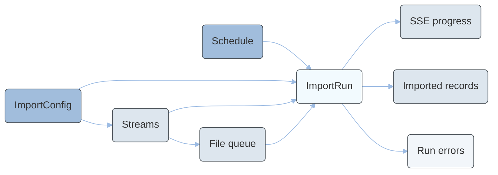

---
seo:
  title: Import Service Tutorials
  description: Learn how to queue files, trigger, schedule, monitor, and inspect import runs with the Import Service.
icon: graduation-cap
layout:
  width: wide
  title:
    visible: true
  description:
    visible: true
  tableOfContents:
    visible: true
  outline:
    visible: true
  pagination:
    visible: true
  metadata:
    visible: true
---

# Import Service Tutorial

The Import Service imports external master data into Emporix. A configuration groups one or more streams, where each stream extracts from a source connection, maps fields to an Emporix target type, and upserts idempotently. Imports run asynchronously. A requested run waits in a shared queue until a worker is free, then executes and streams per-stream progress over Server-Sent Events (SSE).


This tutorial covers queuing files for file-based streams, triggering, scheduling, monitoring, cancelling, and inspecting import runs. An import configuration must already exist for your tenant.

Creating and changing configurations, connections, streams, and mappings requires the `importtool.import_manage` scope. Defining where files come from is administrative; uploading and ordering the files a stream reads is an operating action and uses `importtool.import_trigger`.


The following diagram shows how the main Import Service resources relate to each other:



A typical operational workflow follows these steps:

1. **List configurations** and choose the `configId` you want to run.
2. **Inspect streams** to confirm source entities, target types, and — for file-based streams — `sourceDataset` and `fileMode`.
3. For a file-based stream, **upload files** to the stream's queue and set the load order when the feed is incremental.
4. **Trigger a run** (defaults to run mode `DELTA`; use a `dryRun` first if you want to validate without writing).
5. **Monitor progress** by polling the run endpoint or subscribing to SSE events, and reconcile the run counters.
6. If the run ends as `PARTIAL` or `FAILED`, **retrieve errors** and fix the source data or mappings.
7. **Search imported records** to confirm the expected outcomes.

The sections below walk through each step in detail. All operations use the `importtool.import_trigger` scope documented in the [API Reference](api-reference/).

## Prerequisites

Make sure you have the following:

* A **service OAuth2 token** with the `importtool.import_trigger` scope. For more information, see [Authentication and Authorization](../../quickstart/authentication-and-authorization/README.md).
* An **enabled import configuration** with active streams already exists for your tenant.

## How to inspect import configurations

Before triggering a run, verify that the configuration you want to use exists and is enabled.

To list all import configurations for your tenant, send a request to the [Retrieving all import configurations](https://developer.emporix.io/api-documentation/api-guides/utilities/import-service/api-reference/configurations#get-importtool-tenant-configs) endpoint.

```bash
curl -i -X GET \
  'https://api.emporix.io/importtool/{tenant}/configs' \
  -H 'Authorization: Bearer {{OAUTH2_ACCESS_TOKEN}}'
```

To retrieve a single configuration by its identifier, send a request to the [Retrieving an import configuration](https://developer.emporix.io/api-documentation/api-guides/utilities/import-service/api-reference/configurations#get-importtool-tenant-configs-id) endpoint.

```bash
curl -i -X GET \
  'https://api.emporix.io/importtool/{tenant}/configs/{id}' \
  -H 'Authorization: Bearer {{OAUTH2_ACCESS_TOKEN}}'
```

The response includes fields such as `name`, `enabled`, `deltaEnabled`, and `sourceConnId`. Note the configuration `id` — you need it for scheduling and triggering runs.




[api-reference](api-reference/)


## How to inspect configuration streams

Each configuration contains one or more streams. A stream defines which source entity is extracted, how fields are mapped, and which Emporix target type receives the upserted records.

To list the streams for a configuration, ordered by sequence, send a request to the [Retrieving all streams of a configuration](https://developer.emporix.io/api-documentation/api-guides/utilities/import-service/api-reference/streams#get-importtool-tenant-configs-configid-streams) endpoint.

```bash
curl -i -X GET \
  'https://api.emporix.io/importtool/{tenant}/configs/{configId}/streams' \
  -H 'Authorization: Bearer {{OAUTH2_ACCESS_TOKEN}}'
```

To retrieve a single stream, including its resolved target types, send a request to the [Retrieving a stream](https://developer.emporix.io/api-documentation/api-guides/utilities/import-service/api-reference/streams#get-importtool-tenant-streams-id) endpoint.

```bash
curl -i -X GET \
  'https://api.emporix.io/importtool/{tenant}/streams/{id}' \
  -H 'Authorization: Bearer {{OAUTH2_ACCESS_TOKEN}}'
```

Each stream response includes `sourceEntity`, `targetWriter`, `targetType`, and stream `mode`. The stream `mode` field indicates how the stream contributes to the target:

* `STANDALONE` – the stream upserts records independently.
* `COMPOSITE_CHILD` – the stream contributes child records to a composite parent. When `childStrategy` is `EMBED`, the parent writes those children inside its own instance.
* `COMPOSITE_MERGE` – the stream merges data into a composite parent.

A stream also reports how it addresses its source. Check these fields before you upload files or trigger a run:

* `fileMode` – present on a file-based stream. `SNAPSHOT` means each file is the whole picture; `INCREMENTAL` means each file is a change set. Defaults to `SNAPSHOT`. Changing `fileMode` is an administrative configuration change, not a run option.
* `sourceDataset` – how the stream reads its source. For a file stream, confirm that a natural key is set (`keyField`, or `keyFields` with `keyName`) and note any per-run `limit`. Full format and `arrays` details are in the [API Reference](api-reference/).
* `connectionId` – the source connection this stream reads from when it has its own. Omitted means the configuration's default connection is used.

If `fileMode` is absent, the stream does not read uploaded files. An upload to such a stream returns `409`.




[api-reference](api-reference/)


## How to import files for a stream

Use this workflow when a stream has `fileMode` set. The goal is to get a delimited file (CSV or one of its variants) into Emporix: check limits, upload the file, set the load order when the feed is incremental, then [trigger a run](#how-to-trigger-an-import-run).

Uploading stores the bytes and records their content hash; nothing is imported until a run starts. The same bytes are never imported twice for that stream: a file the stream has already imported is refused rather than queued again. A file that previously failed (`status` `FAILED`) is accepted, because the usual reason is that it has been fixed.

All file-queue operations use the `importtool.import_trigger` scope. Nothing in the queue changes a mapping, a connection, a target type, or a key.

### Check the upload limits

Before sending a large file, read the environment limits from the [Retrieving the file upload limits](https://developer.emporix.io/api-documentation/api-guides/utilities/import-service/api-reference/files#get-importtool-tenant-streams-streamid-files-limits) endpoint.

```bash
curl -i -X GET \
  'https://api.emporix.io/importtool/{tenant}/streams/{streamId}/files/limits' \
  -H 'Authorization: Bearer {{OAUTH2_ACCESS_TOKEN}}'
```

The response includes `maxUploadBytes`, whether that limit comes from the API gateway (`gatewayLimited`), and whether uploading is available at all (`uploadSupported`).

* If `uploadSupported` is `false`, file upload is not configured in this environment. Ask an administrator to enable storage before you continue.
* If the file is larger than `maxUploadBytes`, the upload returns `413`. An administrator can publish the file at an HTTP(S) URL and set that as the connection's file URL instead. Changing a connection requires the `importtool.import_manage` scope and is outside this tutorial.

### Upload a file

To queue a delimited file for the stream's next run, send a multipart request to the [Uploading a file for a stream to import](https://developer.emporix.io/api-documentation/api-guides/utilities/import-service/api-reference/files#post-importtool-tenant-streams-streamid-files) endpoint.

```bash
curl -i -X POST \
  'https://api.emporix.io/importtool/{tenant}/streams/{streamId}/files' \
  -H 'Authorization: Bearer {{OAUTH2_ACCESS_TOKEN}}' \
  -F 'file=@./vendors-2026-10-23.csv'
```

On success, save the returned file `id`. You need it to reorder or remove the file. The request is refused with `409` while the stream's job has a run in flight if the upload would replace bytes the stream already holds. A file the stream has not seen before is accepted at any time.

### List the queue and history

To see what is waiting and what the stream has already dealt with, send a request to the [Retrieving a stream's files](https://developer.emporix.io/api-documentation/api-guides/utilities/import-service/api-reference/files#get-importtool-tenant-streams-streamid-files) endpoint. Use `historyLimit` to control how many already handled files `history` returns. The parameter does not limit `pending`.

```bash
curl -i -X GET \
  'https://api.emporix.io/importtool/{tenant}/streams/{streamId}/files?historyLimit=50' \
  -H 'Authorization: Bearer {{OAUTH2_ACCESS_TOKEN}}'
```

The response separates the work as follows:

* `pending` – files waiting to be imported, in the order they will be read. Each entry includes `id`, `fileName`, and `status` `PENDING`.
* `history` – files already dealt with, newest first. Statuses include `PROCESSED` (read to completion), `FAILED` (the file could not be read, or the import failed for another reason such as the target being unavailable), and `IN_PROGRESS` while a run has claimed the file.
* `pendingTruncated` / `pendingTotal` – when more files are waiting than the response carries, `pendingTruncated` is `true`. You cannot change the load order while it is true, because an order that cannot name every waiting file has no meaning.

Individual record failures do not put a file into `FAILED`. A stream that finishes with record failures still marks its file as imported.

### Set the load order for an incremental feed

When `fileMode` is `INCREMENTAL`, the order is part of the data: a later file's values win on a key an earlier one also carries. Send every waiting file's `id`, in load order, to the [Setting the order in which files are imported](https://developer.emporix.io/api-documentation/api-guides/utilities/import-service/api-reference/files#put-importtool-tenant-streams-streamid-files-order) endpoint. Take the identifiers from the upload response or from `pending`. A list that is not exactly the waiting set is refused. Reordering is refused while a run is in flight, or while `pendingTruncated` is `true`.

```bash
curl -i -X PUT \
  'https://api.emporix.io/importtool/{tenant}/streams/{streamId}/files/order' \
  -H 'Authorization: Bearer {{OAUTH2_ACCESS_TOKEN}}' \
  -H 'Content-Type: application/json' \
  -d '[
    "9b1deb4d-3b7d-4bad-9bdd-2b0d7b3dcb6d",
    "c56a4180-65aa-42ec-a945-5fd21dec0538"
  ]'
```

When `fileMode` is `SNAPSHOT`, skip this step. Each file is the whole picture, so only the most recently arrived one is read in a run. Older pending files can be reported as superseded in that file's `message`. A record missing from a newer snapshot is not deleted.

### Remove a waiting file

To remove a waiting file and delete the stored bytes with it, send a request to the [Removing a file from the queue](https://developer.emporix.io/api-documentation/api-guides/utilities/import-service/api-reference/files#delete-importtool-tenant-streams-streamid-files-fileid) endpoint. Only a waiting file can be removed. Removal is refused while a run is in flight, or when the file has already been claimed or imported.

```bash
curl -i -X DELETE \
  'https://api.emporix.io/importtool/{tenant}/streams/{streamId}/files/{fileId}' \
  -H 'Authorization: Bearer {{OAUTH2_ACCESS_TOKEN}}'
```

### Trigger the import

When the queue is ready, [trigger an import run](#how-to-trigger-an-import-run) for the configuration. The next run drains the waiting files according to `fileMode`. After the run finishes, [monitor the counters](#how-to-monitor-an-import-run) and, if needed, [retrieve errors](#troubleshooting).




[api-reference](api-reference/)


## How to schedule recurring imports

You can run a configuration automatically on a cron schedule.

To check whether a schedule already exists, send a request to the [Retrieving a schedule](https://developer.emporix.io/api-documentation/api-guides/utilities/import-service/api-reference/schedules#get-importtool-tenant-configs-configid-schedule) endpoint. If no schedule is configured, the endpoint returns `204 No Content`.

```bash
curl -i -X GET \
  'https://api.emporix.io/importtool/{tenant}/configs/{configId}/schedule' \
  -H 'Authorization: Bearer {{OAUTH2_ACCESS_TOKEN}}'
```

To create or update a schedule, send a request to the [Scheduling an import run](https://developer.emporix.io/api-documentation/api-guides/utilities/import-service/api-reference/schedules#put-importtool-tenant-configs-configid-schedule) endpoint with a Spring cron expression (six fields), time zone, and `enabled` flag.

```bash
curl -i -X PUT \
  'https://api.emporix.io/importtool/{tenant}/configs/{configId}/schedule' \
  -H 'Authorization: Bearer {{OAUTH2_ACCESS_TOKEN}}' \
  -H 'Content-Type: application/json' \
  -d '{
    "cron": "0 0 2 * * *",
    "timezone": "Europe/Berlin",
    "enabled": true
  }'
```

In this example, the configuration runs every day at 02:00 in the `Europe/Berlin` time zone. The saved schedule response includes `nextFireAt` when a next run time can be calculated.

If the configuration already has a run executing or queued when the schedule fires, the scheduled run waits behind that run instead of being skipped. A later scheduled request is folded into a queued real run of the whole configuration and counted in `supersededRequests`, with `lastRequestedAt` set to the time of that latest request. If the queued run is a dry run, a run of selected streams, or a retry, the scheduled run waits until that run starts and is then queued behind it.




[api-reference](api-reference/)


## How to trigger an import run

To start an import manually, send a request to the [Triggering an import run](https://developer.emporix.io/api-documentation/api-guides/utilities/import-service/api-reference/runs#post-importtool-tenant-configs-configid-runs) endpoint. The endpoint returns immediately with the run in the `QUEUED` status. The run usually starts within moments, when a worker is free, and then has the `RUNNING` status.

```bash
curl -i -X POST \
  'https://api.emporix.io/importtool/{tenant}/configs/{configId}/runs' \
  -H 'Authorization: Bearer {{OAUTH2_ACCESS_TOKEN}}' \
  -H 'Content-Type: application/json' \
  -d '{
    "mode": "DELTA"
  }'
```

Request body fields:

| Field | Required | Description |
| --- | --- | --- |
| `mode` | No | The run mode: `FULL` or `DELTA`. Defaults to `DELTA`. |
| `dryRun` | No | When `true`, maps and validates records without performing remote writes. |

To validate a configuration without writing data, trigger a dry run:

```bash
curl -i -X POST \
  'https://api.emporix.io/importtool/{tenant}/configs/{configId}/runs' \
  -H 'Authorization: Bearer {{OAUTH2_ACCESS_TOKEN}}' \
  -H 'Content-Type: application/json' \
  -d '{
    "mode": "DELTA",
    "dryRun": true
  }'
```

A configuration has at most one run executing and at most one run queued. While the configuration has a run in the `QUEUED`, `RUNNING`, or `RESUMABLE` status, a manual trigger returns `409 Conflict`.

If the tenant already has `maxConcurrentImports` runs executing, the new run stays queued until one finishes instead of returning `429 Too Many Requests`. Read the limit from the [Retrieving import limits](https://developer.emporix.io/api-documentation/api-guides/utilities/import-service/api-reference/license#get-importtool-tenant-license) endpoint.

On success, the response includes the run `id`, `status`, `mode`, and counters such as `recordsRead`, `created`, `updated`, `skipped`, `failed`, and `deleted`. Save the run `id` for monitoring and troubleshooting. The trigger response does not include `mappingVersions`; those versions are fixed when the run starts executing and appear when you retrieve the run. After the run finishes, use the retrieved counters to reconcile the outcome as described in [How to monitor an import run](#how-to-monitor-an-import-run).

To list previous runs for a configuration, send a request to the [Retrieving run history](https://developer.emporix.io/api-documentation/api-guides/utilities/import-service/api-reference/runs#get-importtool-tenant-configs-configid-runs) endpoint.

```bash
curl -i -X GET \
  'https://api.emporix.io/importtool/{tenant}/configs/{configId}/runs?page=0&size=20' \
  -H 'Authorization: Bearer {{OAUTH2_ACCESS_TOKEN}}'
```




[api-reference](api-reference/)


## How to monitor an import run

You can monitor a run by polling its status or by subscribing to the SSE progress stream.

### Poll run status

To retrieve a run together with per-stream progress, send a request to the [Retrieving a run](https://developer.emporix.io/api-documentation/api-guides/utilities/import-service/api-reference/runs#get-importtool-tenant-runs-runid) endpoint.

```bash
curl -i -X GET \
  'https://api.emporix.io/importtool/{tenant}/runs/{runId}' \
  -H 'Authorization: Bearer {{OAUTH2_ACCESS_TOKEN}}'
```

The response contains a `run` object and a `streams` array. Each stream entry includes its own `status` and counters.

While the run is `QUEUED`, it has no per-stream progress. Check these fields on the retrieved run:

* `queueWaitingFor` – `WORKER` (use `queuePosition` for its place in the shared queue), `PREVIOUS_RUN` (the configuration's current run), or `TENANT_LIMIT` (`maxConcurrentImports` is reached).
* `startedAt` – when the run was requested.
* `executionStartedAt` – when execution began. `null` while the run is still queued.

A run can also report the `RESUMABLE` status after an interruption such as a service restart. That status is not final: the run resumes automatically from its last checkpoint. Terminal run statuses are `SUCCEEDED`, `PARTIAL`, `FAILED`, `CANCELLED`, and `ABORTED`. `ABORTED` means the service refused to start the run because of the import configuration, for example unpublished mappings. Nothing was read or written.

### Reconcile the run counters

On both the run and each of its streams, the counters reconcile as follows:

`recordsRead` = `created` + `updated` + `skipped` + `unresolvedParents` + `deleted` + `failed` + `collapsed` + `embedded`

A client that sums only some of these terms will not balance. The following counters are part of that equation:

* `created` / `updated` / `deleted` – records written to the target.
* `skipped` – records left unchanged, or left unread for writing when a license cap was reached.
* `failed` – records that failed.
* `unresolvedParents` – child records that were not imported because their parent could not be found.
* `collapsed` – source rows that repeated a key already present in the same batch. They are merged before the write (last row wins) and counted here. A repeat in a later batch is written again and counted as created or updated.
* `embedded` – child records a `COMPOSITE_CHILD` stream with `childStrategy` `EMBED` handed to its parent, which the parent then wrote inside its own instance. They are not counted as created or updated. If the parent turned out to be unchanged, failed, or absent, these are settled onto `skipped`, `failed`, or `unresolvedParents` once the parent's pass completes.

`duplicateKeys` is a separate signal outside that sum. It counts source rows that repeat a key already imported earlier in the same run and means the feed is not unique on its key.

For a file-based stream, the stream progress also reports file provenance and related signals:

* `filesRead` / `fileNames` – the opaque file locators this stream actually read, in order, and each locator's display name. A retry re-reads these same bytes rather than whatever has since replaced them.
* `capSkipped` – `true` when the licensed `maxRecordsPerEntity` left records read but not written. Raise the limit before those records can be imported; see [Retrieving import limits](https://developer.emporix.io/api-documentation/api-guides/utilities/import-service/api-reference/license#get-importtool-tenant-license).
* `keylessSeen` – `true` when at least one source record had no value in its key column. Check the run errors for `NO_KEY` and fix the source data.
* `sweep` – `true` on the extra progress row produced by the unresolved-parent repair pass. Do not treat that row as a second stream when you aggregate results.

### Stream run progress over SSE

To receive live progress updates, open the [Streaming run progress](https://developer.emporix.io/api-documentation/api-guides/utilities/import-service/api-reference/runs#get-importtool-tenant-runs-runid-events) endpoint. You can open the stream while the run is still queued. The stream sends:

1. An initial `snapshot` event with the run and stream state.
2. A `stream` event for each processed batch.
3. A final `run` event when the run finishes.

```bash
curl -i -N -X GET \
  'https://api.emporix.io/importtool/{tenant}/runs/{runId}/events' \
  -H 'Authorization: Bearer {{OAUTH2_ACCESS_TOKEN}}' \
  -H 'Accept: text/event-stream'
```


`curl` is useful for debugging the event stream. In production, use an SSE-capable HTTP client or `EventSource`.





[api-reference](api-reference/)


## How to cancel an import run

To request cancellation of an active run, send a request to the [Cancelling a run](https://developer.emporix.io/api-documentation/api-guides/utilities/import-service/api-reference/runs#post-importtool-tenant-runs-runid-cancel) endpoint.

```bash
curl -i -X POST \
  'https://api.emporix.io/importtool/{tenant}/runs/{runId}/cancel' \
  -H 'Authorization: Bearer {{OAUTH2_ACCESS_TOKEN}}'
```

A `QUEUED` run is cancelled immediately and gets the `CANCELLED` status, with or without `force`.

For a run that is already executing, cancellation is cooperative by default — the run stops after the current batch completes. To stop the run immediately and unblock the configuration, pass `force=true`:

```bash
curl -i -X POST \
  'https://api.emporix.io/importtool/{tenant}/runs/{runId}/cancel?force=true' \
  -H 'Authorization: Bearer {{OAUTH2_ACCESS_TOKEN}}'
```

A run in the `RESUMABLE` status can be stopped only with `force=true`. Without `force`, the request returns `409 Conflict`.

On success, the endpoint returns `202 Accepted` with `accepted: true`. If the run is already finished or unknown, `accepted` is `false`.




[api-reference](api-reference/)


## How to inspect imported data

After a successful or partial run, verify what was imported.

### List imported data types

To see which target types currently hold imported records, send a request to the [Retrieving imported data types](https://developer.emporix.io/api-documentation/api-guides/utilities/import-service/api-reference/data#get-importtool-tenant-data-types) endpoint.

```bash
curl -i -X GET \
  'https://api.emporix.io/importtool/{tenant}/data/types' \
  -H 'Authorization: Bearer {{OAUTH2_ACCESS_TOKEN}}'
```

### Search imported records by type

To search records of a given target type, send a request to the [Searching imported records](https://developer.emporix.io/api-documentation/api-guides/utilities/import-service/api-reference/data#get-importtool-tenant-data-records) endpoint. The `type` query parameter is required. The optional `search` parameter filters by natural key.


The `search` parameter performs a case-insensitive substring match on the record's natural key only. It is not the Emporix query language, so field selectors and operators (for example `field:value`, comparisons, or boolean logic) are not supported.


```bash
curl -i -X GET \
  'https://api.emporix.io/importtool/{tenant}/data/records?type=product&search=SKU-1001&page=0&size=20' \
  -H 'Authorization: Bearer {{OAUTH2_ACCESS_TOKEN}}'
```

Each record includes `naturalKey`, `targetType`, `fields`, `outcome` (for example `CREATED` or `UPDATED`), and `importedAt`.

### Search records for a specific stream

To search only the records produced by one stream, send a request to the [Searching a stream's imported records](https://developer.emporix.io/api-documentation/api-guides/utilities/import-service/api-reference/data#get-importtool-tenant-data-streams-streamid-records) endpoint. The optional `search` parameter uses the same natural-key substring filter as the type-based search endpoint.

```bash
curl -i -X GET \
  'https://api.emporix.io/importtool/{tenant}/data/streams/{streamId}/records?search=&page=0&size=20' \
  -H 'Authorization: Bearer {{OAUTH2_ACCESS_TOKEN}}'
```




[api-reference](api-reference/)


## Troubleshooting

When a run finishes with status `PARTIAL` or `FAILED`, inspect the recorded errors.

To retrieve paginated errors for a run, send a request to the [Retrieving run errors](https://developer.emporix.io/api-documentation/api-guides/utilities/import-service/api-reference/runs#get-importtool-tenant-runs-runid-errors) endpoint.

```bash
curl -i -X GET \
  'https://api.emporix.io/importtool/{tenant}/runs/{runId}/errors?page=0&size=50' \
  -H 'Authorization: Bearer {{OAUTH2_ACCESS_TOKEN}}'
```

Each error record includes:

* `naturalKey` – the source natural key of the offending record.
* `streamId` – the stream where the error occurred.
* `stage` – the pipeline stage, for example extraction or mapping.
* `errorCode` – a machine-readable error code.
* `message` – a human-readable description.

Use these fields to identify which source records failed and at which stage of the import pipeline. The following `errorCode` values are especially useful when diagnosing a failed or partial run:

* `VALIDATION` – the mapped record failed validation before any write was attempted.
* `NO_KEY` – the record's key column was empty.
* `UPSERT` – the target rejected the write.
* `CONFIGURATION` – something to change in the import's own configuration, for example a missing base URL or a stream that names no parent. This is not an application fault.
* `EXTERNAL_SYSTEM` – another system answered with an error, for example the source returning 5xx.
* `REJECTED_BY_SOURCE` – the source rejected a single record because of its data, for example a CSV row whose nested list is longer than the stream allows. That record is not imported, but the rest of the file is. The `message` names the column, the number of elements, and the limit.
* `STREAM_ERROR` – the stream failed as a whole; the record-level detail is in `message`.

For `CONFIGURATION` and `EXTERNAL_SYSTEM`, the `message` is a plain sentence naming what to change. The service does not treat them as application faults for alerting. Composite merge and embed failures use additional codes documented in the [API Reference](api-reference/); follow the `message` for the next action.

After you fix the source file or configuration, re-upload a previously `FAILED` file if needed, then [trigger another run](#how-to-trigger-an-import-run).




[api-reference](api-reference/)
